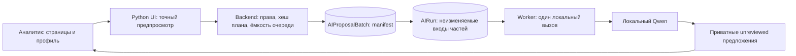

# Пакетный запуск ИИ по PDF-страницам — GS-029

8 ноября 2026. Аналитик выбирает диапазон оригинальных PDF-страниц, проверяет точный вход и запускает все части одним действием. Сохраняются приватный пакет, исходные координаты и отдельные результаты. Предложения остаются `unreviewed` до ручного решения.

## Как пользоваться

1. Загрузить PDF и дождаться полного извлечения. Открыть AI workspace компании.
2. В Selected PDF pages выбрать документ, первую и последнюю страницу и локальный профиль. Нумерация относится к страницам файла, не печатным номерам отчёта.
3. Нажать Preview page batch. Раскрыть запросы: каждый показывает точный текст, исходную страницу, диапазон символов и ссылку на полный элемент. Пустые страницы перечислены отдельно.
4. Нажать Start selected-page batch. Страница пакета показывает завершённые части, ошибки и количество предложений. Refresh batch обновляет прогресс; Part открывает результат и сохранённый вход.
5. При необходимости Cancel pending parts отменяет только ожидающие/выполняемые части. Retry failed or cancelled parts повторяет только неудачные и отменённые; успешные результаты сохраняются.

После отмены текущий вызов может ещё работать. Его ответ отбрасывается, а повтор доступен после освобождения блокировки. Отмена не выдаётся за мгновенную остановку GPU. Загрузка страницы результата не запускает ИИ повторно.

## Ограничения первой версии

Один диапазон содержит 1–25 страниц и не более 10 запросов. Каждый запрос ограничен существующим лимитом GS-028: до 6000 символов JSON доказательств и восьми исходных элементов. Длинные элементы разбиваются с сохранением исходного индекса и диапазона символов. Слишком большой диапазон отклоняется целиком с предложением уменьшить выбор; тихой обрезки нет.

Все части должны помещаться в общую очередь аналитика из десяти ожидающих/выполняемых AI-задач. Создание атомарное. Повтор того же предпросмотра возвращает тот же пакет. Разные пересекающиеся пакеты имеют самостоятельные дочерние задачи, поэтому отмена одного не отменяет другой. Пакеты доступны только автору в своей организации.

Выбор раздела по названию и соседний контекст с отдельными ссылками запланированы в GS-030. Предложение CPU при нехватке GPU — GS-031. Сейчас пакет содержит только явно выбранные страницы; резерв 3 GiB не гарантирован механизмом допуска. Качество на реальных эталонах и обновление девяти метрик за десять минут ещё не подтверждены.

## Компоненты

`ai_batches.py` строит диапазоны, проверяет весь план при POST, создаёт пакет и управляет отменой/повтором. Manifest фиксирует исходный хеш, parser, модель/digest, prompt/schema, страницы и хеш входа каждой части. Worker проверяет сохранённый manifest и текущую конфигурацию перед вызовом. Изменение входа или конфигурации блокирует запуск. `ai_batches_ui.py` показывает предпросмотр и общий прогресс; результаты используют существующий экран `ai-run`.

Новый оркестратор не требуется: существующая транзакционная очередь уже обеспечивает ограничение GPU, повтор и восстановление. Слой адаптеров позволяет менять локального провайдера. Браузер обращается только к backend.

## Обновление и проверка

Миграция `0017` добавляет `ai_proposal_batches`. Обновлять приложение и backup-образ вместе: актуальный backup проверяет именно схему 0017. Старую копию восстанавливать соответствующим ей старым образом, затем выполнять миграции приложения. Не подменять номер схемы внутри копии.

Проверки 8 ноября: полный pytest — 284 passed / 1 skipped; Linux OCR отдельно прошёл. PostgreSQL проверил конкурентное создание одного пакета, отмену во время вызова, сохранение блокировки и повтор без параллельного inference. Chrome с локальным Qwen обработал две выбранные страницы синтетического PDF, получил по одному предложению, проверил исходники и переходы на desktop/mobile; также прошли 15 базовых сценариев. Ошибок JS, внешних запросов и переполнения мобильной страницы нет.

Development-извлечение JPMorgan, оригинальные страницы 197–199: три исходных элемента, два запроса, выбранный текст восстанавливается побайтно в строковом представлении без пропусков. Это проверка построения входа, без вызова ИИ и без ручной приёмки фактов. Резерв GS-004 не использовался.

Локальные снимки интерфейса: `design/previews/ai-batch-preview.png`, `ai-batch-result.png` и мобильные варианты. Исходники, синтетические тесты и инструкции публикуются; оригиналы, извлечения и снимки остаются локальными.

Зашифрованная тестовая копия схемы 0017 восстановлена на чистом стенде: 34 таблицы, четыре файла, 15 HTTPS-сессий. Manifest пакета совпал с сохранённым, чужому аналитику доступ закрыт, отменённая часть успешно поставлена на повтор и корректно сообщила об отключённом ИИ. Незавершённый PDF продолжился с 26-й страницы. Проверены отказы повреждённому оригиналу и восстановлению поверх существующих данных. Первая попытка со старым backup-образом 0016 была отклонена проверкой схемы; после обновления образа весь сценарий прошёл.
