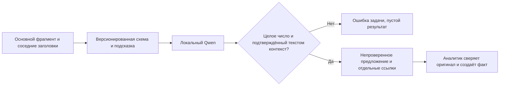

# Контекст предложений локального ИИ

24 ноября 2026. Техническое продолжение GS-004 (P0, REVIEW), после проверки целых числовых токенов. Реальные эталоны, accuracy/precision/coverage 95% и обновление модели за десять минут ещё не приняты.

## Изменение поведения

Ранее Qwen мог сохранить число и оставить валюту, масштаб и период пустыми даже при явном заголовке рядом. В новом контракте одна описанная JSON-схема передаётся и в `format`, и текстом в подсказку. Поля остаются nullable: недостаток контекста нельзя заменять догадкой. Это соответствует рекомендации [Ollama о structured outputs](https://docs.ollama.com/capabilities/structured-outputs). Само наличие `null` в схеме не было доказанной причиной дефекта.

Для локального Qwen3 4B проверены явный заголовок, отсутствие заголовка, приоритет основного текста, противоречащие заголовки, несколько лет и чужая компания. Синтетические примеры используются при разработке подсказки и **не являются независимым тестовым корпусом**.

## Проверка на сервере

`inference.py` получает ответ локальной модели; `ai_context.py` проверяет каждое заполненное поле перед сохранением результата:

- Валюта — явный поддерживаемый ISO-код в основном тексте или процитированном контексте. У денежных метрик допускается единственный непротиворечивый код; у коэффициентов валюта отсутствует.
- Масштаб — явно названная величина. Единственное/множественное число (`million` / `millions`) эквивалентны для проверки; дословный ответ не переписывается. Не допускается замена миллионов миллиардами или процентов денежным масштабом.
- Период и периметр — текст из основного или процитированного фрагмента, с нормализацией пробелов и регистра. Явный год основного фрагмента имеет приоритет; несколько конкурирующих лет не позволяют выбрать колонку автоматически.
- Определение — подпись метрики из основного текста, а не объяснение из общих знаний модели.
- Соседний фрагмент, использованный для заполнения, должен быть указан в `context_ids`. При поиске конфликтов учитываются все переданные соседние фрагменты, а не только выбранные моделью ссылки.

Пустое поле остаётся пустым. Проверка ничего не дописывает и не выполняет валютных пересчётов. При нарушении возвращается `unsupported_context`, весь ответ отбрасывается. Финансовый факт и решение аналитика автоматически не создаются.



Это **не проверка экономического смысла**: наличие валюты в тексте не доказывает, что она относится к нужной компании или колонке. Распознавание сущностей, сравнительных колонок, отчётного периметра и финансовых определений остаётся задачей модели и аналитика. Проверка лет консервативна: число вида 1900–2099 может быть принято за год; сравнительные таблицы и интервалы могут требовать ручной работы. Символ `$` не выбирает ISO-валюту автоматически. Сокращения масштаба вне поддерживаемых написаний могут быть отклонены. Полнота извлечения этим фильтром не доказывается.

## Компоненты и версии

`context_schema()` строит общую схему с описаниями полей и перечнем валют из нормализатора. `context_prompt()` добавляет её статическую часть к инструкции. Зависящие от документа списки чисел и идентификаторов передаются только в ограничениях ответа; размер подсказки не растёт вместе с документом. Проверки фиксируют её хеш и ограниченный размер.

Версии: `metric-proposal-context-v3-schema` и `gs004-cited-context-v1`. Они входят в спецификацию пакета и результат. Старый незавершённый контекстный пакет с другим контрактом прекращается до вызова ИИ с `batch_configuration_changed`: нужен новый предпросмотр и запуск. Успешная история не переписывается. Обычные предложения без соседнего контекста, сводки, веса моделей и финансовая арифметика сохраняют прежние контракты. Миграция БД не требуется; актуальная схема — 0022.

Используется существующий поиск соседних фрагментов GS-030 — ограниченный вариант retrieval: сначала выбирается текст документа, затем он передаётся модели вместе с координатами. Wrapper — адаптер `OllamaProvider` и проверка ответа на сервере. Дополнительный агентный framework для этого фиксированного пути не нужен. Клиент по-прежнему обращается только к серверному API.

## Как проверить в кабинете

1. Откройте извлечённый PDF и **Choose section by title**.
2. Выберите раздел, откройте **Preview section** и проверьте основные фрагменты и отдельный соседний контекст.
3. Запустите пакет с локальным профилем. Если GPU недоступен, сохраняется прежнее ожидание с возможностью явного выбора CPU.
4. В результате проверьте валюту, масштаб, период и **Context source**. Результат остаётся **Unreviewed**.
5. Перейдите в **Check context and create a fact**, сверьте оригинал и явно задайте нормализованные единицы. Предложенное `million` само не превращается в расчётный факт.

При ошибке контекста можно сверить оригинал вручную. Повтор с тем же входом и фиксированным seed не обещает более качественный ответ; неподтверждённые значения не следует обходить ослаблением проверки.

## Воспроизводимая диагностика

```powershell
Get-Content scripts/check_context_grounding.py -Raw -Encoding UTF8 | wsl -d Ubuntu -- docker compose exec -T worker python - --profile qwen4
```

Скрипт выполняется при свободной очереди под общей блокировкой и `DeviceGuard`. Он сохраняет прежний резерв 3072 MiB, не переключается на CPU автоматически и не пишет факты. `matched` означает совпадение ожидаемого предложения; `safely_blocked` — отклонение неоднозначного ответа. Эти результаты нельзя складывать в accuracy ИИ. Поддерживается явный выбор `--profile qwen_small` и одного `--case`; качество меньшей модели не предполагается равным 4B.

Результаты финальных проверок дополняются после проверки опубликованного кандидата. Локальные сырые диагностические журналы находятся в игнорируемой `.build-context/`; реальные документы и резерв GS-004 не использовались.

## Локальные результаты 24 ноября 2026

Интеграционные проверки — 132 passed; после добавления проверки singular масштаба целевой набор — 25 passed. Сохраняется предупреждение Starlette TestClient о httpx. Окончательный код развёрнут локально, все сервисы healthy, схема 0022.

| Диагностический вход, Qwen3 4B | Результат |
|---|---|
| Три метрики и явный заголовок USD millions / 2025 | Три целых числа; денежные USD/millions, ROE percent без валюты; период и отдельные ссылки заполнены |
| Контекст отсутствует | Валюта, масштаб и период null |
| В основном тексте EUR thousands / FY 2024, рядом USD / 2025 | Сохранён контекст основного текста |
| Два противоречащих заголовка | Ответ отклонён сервером, unsupported_context |
| Два года без привязки числовой колонки | Ответ отклонён сервером, unsupported_context |
| Заголовок явно другой компании | Валюта, масштаб и период null |

Итого: четыре ожидаемых ответа и два защитных отказа, а не шесть правильных разметок. На первом примере вызов модели занял 3,215 с, полный цикл контроля устройства — 5,497 с. Минимум свободной памяти среди шести запусков — 6315 MiB при требуемых 3072 MiB; выгрузка подтверждена. Это не замер пользовательской нагрузки и не десятиминутный процесс.

Chrome проверил выбор раздела, точный предпросмотр, пакет, отдельную ссылку на контекст и 15 базовых сценариев. На продолжении синтетического отчёта получены USD, исходное million, year ended 2025 и одна ссылка (qualityPassed=true). Desktop/mobile без переполнения, JS-ошибок и внешних запросов; временный QA-аккаунт отозван. Локальные снимки — design/previews/section-context-filled.png и section-context-mobile.png. Никаких реальных gold-фактов не утверждено.
