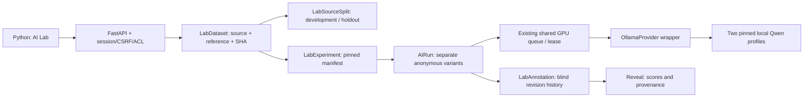

# AI Lab — GS-021

31 октября 2026. Личная лаборатория сравнения двух установленных Qwen на одинаковых входах. Это инструмент измерения, не подтверждение accuracy 95% и не независимая методическая приёмка.

## Как пользоваться

1. Загрузите английский оригинал и выполните Extract. Для выбора цитат сначала подтвердите факты в Review.
2. Откройте **AI Lab → Create a dataset**. Выберите **Extract metrics** с оригиналом/offset либо **Select citations** с компанией; нажмите **Load evidence**.
3. Проверьте показанный исходный текст. Для метрик внесите ожидаемые показатели, полный числовой токен, дословную цитату и явно заданный контекст. Отсутствующий контекст оставьте пустым. Для сводки отметьте релевантные фрагменты. Пустой эталон означает отсутствие релевантных фактов.
4. Выберите development для разработки или holdout для финального сравнения. Один исходный файл внутри пространства аналитика не может принадлежать обеим частям. Сохраните проверенный эталон.
5. Нажмите **Compare local models**. Оба варианта используют один зафиксированный набор свидетельств; выполняются последовательно общей очередью. Обновляйте страницу для статуса. Можно отменить очередь или повторить неудачные варианты после освобождения GPU lease.
6. В **Blind review** сопоставьте каждый ответ с источником и эталоном. Выберите Correct / Incorrect / Uncertain и объясните решение. Исправления сохраняются новыми ревизиями до раскрытия; конфликтующие записи требуют обновить страницу.
7. После завершения очереди и оценки всех успешных ответов нажмите **Reveal models and scores**. Появятся имена профилей, precision/recall/F1, цитаты, контекст, время, токены и полный JSON receipt. После раскрытия результаты и разметка закрыты для изменения.

Интерфейс создаёт один case в наборе. API поддерживает 1–4 разных case одного типа и ровно два разных профиля. Максимум десять ожидающих AI-заданий на аналитика, включая обычную работу. Каждый вариант имеет отдельный AIRun; повторное создание того же эксперимента возвращает существующий результат, а не запускает GPU снова.

## Что означает качество

- Метрика совпала, когда совпадают evidence ID, код показателя и числовой токен после строгого разбора. Проценты не приравниваются к абсолютным числам. Контекст проверяется отдельно, масштаб автоматически не конвертируется.
- **Precision = matched / predicted**, **recall = matched / expected**, **F1 = 2 × matched / (predicted + expected)**. Это micro-average по всем case набора. Нулевой знаменатель даёт N/A, не 100%.
- Один эталон соответствует максимум одному ответу: дубликаты уменьшают precision. При одинаковых значениях сначала выбирается ещё не сопоставленный эталон с наиболее близким контекстом.
- Неудачные и отменённые варианты считаются отсутствующими ответами и уменьшают recall; они не исчезают из знаменателя. Пустые негативные case сохраняются, но сами по себе не доказывают высокую precision.
- **Context accuracy** — отдельная точность точного текстового соответствия currency, scale, period, perimeter, definition среди сопоставленных метрик. Например, `million` и `millions` различаются. Это консервативная проверка контекста, не семантический судья. Ошибка контекста может сосуществовать с правильным числом; высокий precision отдельно не означает пригодности расчёта.
- **Citation precision** — доля ответов с существующим evidence ID и непустой дословной цитатой. Для сводок precision/recall измеряют выбор эталонных evidence ID, не литературное качество текста.
- Ручные verdict и причины хранятся отдельно от автоматических баллов. Разметка, выполненная программой на синтетике, не считается независимым человеческим заключением.
- Seconds — сумма времени успешных вызовов провайдера; ожидание очереди и неудачные попытки сюда не включены. Tokens — eval_count успешных ответов. Если измерения отсутствуют, показывается N/A. Денежная стоимость неизвестна без тарифа и замера энергии.

Цель 95% остаётся открытой: нужны реальный независимый эталон GS-004, согласованный объём/распределение, правила контекста и ручная приёмка. `quality_target_confirmed` всегда false в техническом v1; показатель не переключается по одному маленькому тесту.

## Версии, holdout и слепой просмотр

Dataset сохраняет неизменяемые evidence, provenance исходного файла, ожидаемые ответы, split, policy и SHA-256. Ревизия создаёт новый объект с parent_id; старый не меняется. Повтор точно того же содержимого возвращает старый объект. Повторные входы внутри набора отвергаются с учётом исходного хеша, текста и положения, независимо от ID загрузки.

Реестр LabSourceSplit закрепляет SHA-256 исходного документа за development/holdout внутри аналитика, в том числе между метриками и цитатами. После создания эксперимента на holdout его документы нельзя заново разметить/упаковать в другой набор; новые конфигурации требуют новых документов. Нужные наборы разных типов следует размечать до первого holdout-эксперимента. Повторная отправка исходного запроса возвращает тот же эксперимент.

Это техническая защита от утечки внутри AI Lab, не доказательство независимости: приложение не знает, видел ли аналитик ответы вне лаборатории, использовал ли файл другой аналитик или попал ли отчёт в обучение модели. Независимый проверяющий пока не назначен. Историческая версия эталона не становится текущим подтверждённым финансовым входом при изменении проверки источника.

Experiment фиксирует версии dataset/scoring, digest моделей, system prompt и schema hash, seed, temperature, context и output limit. В manifest случайно назначается соответствие профиля и анонимного Variant 1/2. Входы сравнимы внутри одного case и одного типа задачи; разные задачи/наборы не объединяются в единый рейтинг. Provider receipt дополнительно хранит фактические хеши запроса и динамической схемы с допустимыми ID/числами.

При изменении закреплённого профиля/промпта до выполнения worker возвращает `experiment_version_changed`. Несоответствие receipt — `experiment_receipt_mismatch`. Это воспроизводимость входа и версии, а не обещание побитово одинаковой генерации на любом GPU/runtime.

До раскрытия API/HTML скрывают модель, digest, время и токены. Обычные AI routes не дают получить/повторить lab-run в обход этого режима. Ошибки, ответы, источник и эталон доступны владельцу. Имена моделей могут угадываться по стилю — это неизбежное ограничение, а не криптографическая анонимность.

## Компоненты и системный дизайн

- `ai_lab.py`: private APIs, immutable references/manifests, split protection, queue creation, annotation and reveal gates.
- `lab_scoring.py`: versioned deterministic metrics. No AI judge.
- `ai_lab_ui.py`: source selection, reference forms, blind review and comparison, all rendered in Python.
- `models.py`, migration `0014_ai_lab.py`: four new tables; existing AI queue remains the execution store.
- `inference.py`: pinned adapter specification; summary eval_count. `ai_runs.py`: shared scheduling, runtime specification check, hidden lab runs.
- `health.py`: expected migration advanced to 0014.

**Wrapper** — существующий Python-адаптер вокруг Ollama: он фиксирует допустимые модели, формат запроса, лимиты и проверки ответа. AI Lab вызывает его через worker. **RAG** используется для получения подтверждённых фактов в задаче выбора цитат; поиск выполняется один раз при сохранении набора, чтобы оба варианта видели одинаковые результаты. Затем повторного поиска нет. LangGraph/CrewAI/MCP для этого фиксированного сравнения не добавлены: существующая транзакционная очередь обеспечивает нужные состояния, lease и аудит. Браузер не получает прямого доступа к Ollama.

## Проверки

См. итог в CHANGELOG.md и issue GS-021: API/ACL, версии и разметка, проверка PostgreSQL с конкуренцией, браузер с реальным локальным ИИ. Тестовые примеры синтетические. Изображения интерфейса сохраняются локально в design/previews/lab-*.png; публичный репозиторий не содержит пользовательских документов и снимков.
