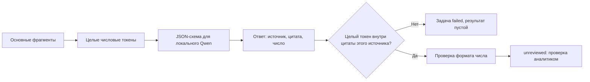

# Целое число в цитате ИИ

24 ноября 2026. Исправление дефекта в технической части GS-004. Результаты предложений по-прежнему требуют проверки аналитиком; реальная accuracy 95% этим не подтверждается.

## Воспроизведённая ошибка

Сервер проверял, что `number_text` встречается как подстрока в цитате. JSON-схема ограничивала число общим списком токенов из всех основных фрагментов. Если `12` присутствовало в другом фрагменте, это не мешало связать его с цитатой `Profit 120`. Даже обрезанная цитата `120` из `Loss (120)` проходила проверку. Аналогично терялся процент в `12.5%`.

| Переданный основной текст | Предложение ИИ | До исправления | Сейчас |
|---|---|---|---|
| `Profit 120` | `12` | Принималось | Отклоняется |
| `Loss (120)` | `120` | Принималось | Отклоняется |
| `Margin 12.5%` | `12.5` | Принималось | Отклоняется |
| `Loss ( 120 )` | `( 120 )` | Зависело от прежнего разбора | Сохраняется целиком, остаётся unreviewed |
| `Profit 120` | `120` | Принималось | Принимается как unreviewed |

Ручная нормализация фактов имела отдельную проверку границ числа. Она не заменяет проверку более раннего предложения ИИ: ошибочное число не должно доходить до аналитика как корректно процитированное предложение.

## Как работает проверка



`ai_numbers.py` предоставляет один разбор чисел для JSON-схемы и серверной проверки. Знак, скобки, десятичная часть, разделители тысяч и процент принадлежат числу. Пробелы между знаком/скобками/процентом и цифрами не дают отбросить эти признаки. Неподдерживаемая запись вроде `- 120` отклоняется нормализатором, а не исправляется в положительное число. Завершающая точка предложения не превращается в десятичную часть.

Проверяются точные границы токена в переданном основном тексте и вхождение полной цитаты в этот же текст. Если цитата повторяется, достаточно одного вхождения, содержащего целый выбранный токен. Число вне цитаты, в другом фрагменте или только в соседнем контексте не подтверждает предложение. Контекст продолжает иметь собственные ссылки и не становится источником нового значения.

Проверка доказывает присутствие числа в переданном фрагменте. Она не доказывает правильность выбранной строки/колонки, валюты, периода, определения метрики или периметра. Фрагменты длинных документов имеют собственные исходные диапазоны; окончательная ручная нормализация дополнительно проверяет полный исходный элемент. Заполнение Qwen контекстных полей из GS-030 остаётся отдельным открытым вопросом качества.

## Версии и существующие задачи

В спецификации новых числовых задач и квитанции провайдера записывается `number_validation: gs004-whole-number-v1`. Промпты, веса, сводки и финансовая арифметика не меняются. Для сводок сохраняется прежний контракт дословного вывода источников.

Сохранённые успешные результаты и факты не переписываются. Старые незавершённые пакеты страниц и эксперименты AI Lab имеют зафиксированную спецификацию: после обновления они завершаются с `batch_configuration_changed` / `experiment_version_changed` до вызова модели. Создайте новый предпросмотр пакета или новый эксперимент с текущими правилами. Повтор прежнего объекта не обновляет его контракт. Одиночные предложения используют текущую проверку, её версия видна в **Versions and provenance** результата.

При `unsupported_evidence` результат целиком отбрасывается, включая другие предложения из того же ответа. В кабинете задача получает `failed`; можно проверить оригинал вручную или повторить запрос. Факт и решение аналитика автоматически не создаются.

## Проверки

Локальный целевой набор — **89 passed**: знаки, скобки, проценты, десятичные части, разные источники, обрезанные и повторные цитаты, одиночный/контекстный провайдер, отказ очереди без записи фактов, защита версии пакетов и AI Lab. Исправлены прежние тесты неподдержанной цитаты: теперь они передают полную валидную структуру и действительно достигают проверки доказательства, вместо раннего отказа схемы.

Дополнительная диагностика `scripts/check_number_grounding.py` запускается внутри worker только при пустой очереди, под общей блокировкой и существующим контролем резерва GPU. Она использует три синтетических показателя и не сохраняет факты. Команда:

```powershell
Get-Content scripts/check_number_grounding.py -Raw -Encoding UTF8 | wsl -d Ubuntu -- docker compose exec -T worker python -
```

Диагностика проверяет работу установленного Qwen с новой схемой; её результат не является слепым эталоном, проверкой 45 документов/день или доказательством 95%. Исходные документы и закрытый резерв GS-004 для этого исправления не использовались.

Локальный Qwen3 4B прошёл синтетический пример: assets `1,200`, profit `(120)`, ROE `12.5%` сохранены без изменений. Вызов 3,016 с; полный контроль загрузки/выгрузки 66,651 с; минимум свободной VRAM 5010 MiB при резерве 3072 MiB, выгрузка подтверждена. Валюта/масштаб/период/периметр остались null, context_ids пусты — это сохраняющийся пробел контекста, не пройденная разметка.
