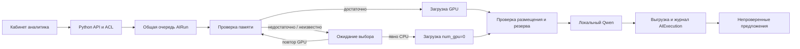

# GS-031 — устройство и резерв памяти

Согласованное поведение: сохранять 3 GiB свободной VRAM, при невозможности предложить CPU. Решение принимает аналитик. Контроль применяется к одиночным предложениям и сводкам, пакетам страниц и AI Lab через общую последовательную очередь. Браузер обращается только к серверу.

## Работа в кабинете

1. Запустить задачу или пакет обычным способом. По умолчанию запрошен GPU.
2. Если доступ к GPU не подтверждён, задача получает `awaiting_device`. Страница показывает **Run on CPU**, **Check GPU again** и отмену. Автоматического перехода на CPU нет.
3. **Run on CPU** явно выбирает CPU для этой задачи; у пакета или эксперимента — для всех ещё queued/awaiting частей. Успешные и уже выполняющиеся части сохраняются. **Check GPU again** возвращает эти части на проверку GPU.
4. Открыть карточку попытки: выбранное и обнаруженное устройство, время, память до/после загрузки, минимальный замер и подтверждение выгрузки. Неизвестные значения остаются неизвестными.

Ожидающие решения задачи входят в лимит десяти незавершённых задач аналитика, но не удерживают очередь других сотрудников. Повтор failed/cancelled сохраняет последнее выбранное устройство. Во время активного вызова отмена отбрасывает будущий результат; очередь ждёт его завершения и выгрузки.

В AI Lab устройство, тайминги и история попыток доступны после раскрытия моделей. Входы, prompt/schema и версии эталона не меняются при выборе устройства. Нельзя непосредственно сравнивать скорость CPU и GPU или разных условий нагрузки. Ранее выполненные попытки без измерения не получают придуманную историю.



## Контроль допуска и ограничения

Политика `gs031-device-v1` предназначена для одного NVIDIA GPU. `nvidia-smi` возвращает только индекс, общую и свободную память. Недоступная/некорректная телеметрия и несколько GPU закрывают допуск. Имена процессов и содержимое других приложений не собираются.

До загрузки требуется свободная память не меньше **3072 MiB + бюджет профиля**: 6144 MiB для Qwen 4B и 4096 MiB для Qwen 1.7B. Это консервативные бюджеты допуска. Они могут отклонить задачу, которая фактически поместилась бы; увеличение моделей требует новой проверки политики. После загрузки повторно проверяются `size_vram` из `/api/ps` и свободная память. GPU обязан действительно использовать VRAM; CPU обязан иметь `size_vram=0`. Запрос CPU задаёт `num_gpu=0`, два CPU-потока. Локальная модель и её digest фиксированы.

Во время GPU-вызова память опрашивается раз в секунду; нарушение резерва или потеря телеметрии помечаются в квитанции, результат не выдаётся как успешный, требуется новое решение. Это **не аппаратная квота VRAM**: внешняя программа может занять память между замерами. Текущий вызов при таком событии не прерывается мгновенно; по завершении выполняется выгрузка. Мгновенный пик между замерами может остаться незамеченным. Собственную реальную параллельную нагрузку пользователя ещё предстоит принять в GS-024.

Ollama дополнительно получает `OLLAMA_GPU_OVERHEAD=3221225472`, одну загруженную модель и один параллельный запрос. Worker получает GPU utility capability только для измерений; Docker socket ему не предоставляется. Сервис ИИ остаётся во внутренней сети. Без `compose.gpu.yaml` телеметрия обычно недоступна: кабинет предложит явный CPU.

Пределы: загрузка до 90 секунд, запрос провайдера до 180 секунд, lease 420 секунд с запасом на контроль/выгрузку. Медленный CPU может превысить timeout; это failed, а не бесконечное ожидание. При неподтверждённой выгрузке lease сохраняется до срока. Последующий запуск также проверяет пустой `/api/ps`; занятый сервер не используется. Оператор проверяет локальный inference-сервис, не обходит контроль и не открывает его наружу.

`seconds` попытки включает допуск, загрузку, вызов и очистку. `result.seconds` — прежний тайминг вызова. Оба исключают ожидание в очереди; ни один не доказывает десятиминутное обновление модели.

## Компоненты и эксплуатация

- `ai_resources.py`: политика, измерение, проверка размещения, выбор устройства и история.
- `ai_runs.py`: общий lease, сохранение попыток, ожидание решения, отмена/отзыв доступа.
- `ai_batches.py`, `ai_lab.py`: групповой выбор без изменения зафиксированных входов.
- `ai_resources_ui.py`: общий интерфейс решения и карточки попыток.
- Миграция `0018`: поле `AIRun.device` и таблица `AIExecution` с номером попытки. Приватность наследуется от родительской задачи, отдельного публичного endpoint нет. История старой попытки не переписывается при повторе; незавершённая попытка после сбоя помечается interrupted.

Обновить приложение и backup-образ вместе. Актуальный backup поддерживает **0018**. Старые копии восстанавливать соответствующим им образом, затем мигрировать. Никогда не менять номер схемы внутри копии вручную.

Для этого локального стенда сохранить порт:

```powershell
wsl -d Ubuntu -- env GS_WEB_PORT=8081 docker compose -f compose.yaml -f compose.gpu.yaml --profile ai up -d --build
wsl -d Ubuntu -- docker build -t goldenstock-ops:local ops
```

Диагностика `scripts/check_ai_resources.py` запускается внутри worker через stdin только при пустой очереди. Она удерживает общую блокировку, использует синтетическую строку, проверяет GPU и CPU и печатает только квитанции. `GS_QA_RESOURCES=1` для `scripts/check_browser.py` создаёт отдельно помеченное **симулированное** ожидание нехватки памяти, затем кнопка в браузере запускает реальный Qwen на CPU. Память пользовательского GPU для такого теста намеренно не исчерпывается. Тестовый аккаунт отзывается после прогона.

## Измерения и границы приёмки

8 ноября 2026, RTX 3080 Ti 12 GiB, Qwen 4B, короткий синтетический фрагмент: перед GPU-загрузкой 9879 MiB свободно, после 6490 MiB, минимум за опрос 6484 MiB; модель использовала 3 571 659 904 байт VRAM. Попытка 43,439 с, сам вызов 1,747 с. CPU: `size_vram=0`, попытка 32,166 с, сам вызов 30,647 с. Различаются холодная загрузка и кэш; это не честный сравнительный benchmark производительности. Выгрузка в обоих случаях подтверждена.

Качество реальной разметки, полный путь до десяти минут, 45 документов/день и совместная нагрузка других программ не приняты. Открытый пробел заполнения контекста GS-030 не устранён этой задачей. Эталонные факты и методические подписи автоматически не создаются.

Технические основания адаптера: [параметры Runner в закреплённом Ollama v0.13.5](https://github.com/ollama/ollama/blob/v0.13.5/api/types.go), [GPU overhead](https://github.com/ollama/ollama/blob/v0.13.5/envconfig/config.go), [состав ответа /api/ps](https://docs.ollama.com/api/ps). LangGraph/CrewAI для этой задачи не нужны: проверка допуска выполняется детерминированным Python-кодом до адаптера модели.

Итог локальных проверок: полный набор 303 passed / 1 skipped, затем 36 passed по окончательным границам очереди/устройства. Linux OCR и PostgreSQL прошли. Chrome проверил явный CPU с реальным Qwen 1.7B (25,441 с, 0 байт VRAM), новый GPU-пакет с контекстом и 15 базовых сценариев; JS-ошибок, внешних запросов и мобильного переполнения нет. Снимки desktop/mobile просмотрены локально. Зашифрованное восстановление вернуло 35 таблиц, четыре файла, историю AI-попыток, продолжение PDF и 15 HTTPS-сессий.

Опубликованный кандидат `58136f0b42073cd71ee565df02b238965804bd0a` прошёл [GitHub CI](https://github.com/Villentretermert/GoldenStock/actions/runs/42500401750): **306 passed / 1 skipped**, отдельный Docker OCR, PostgreSQL, изоляция и восстановление **0018 / 35 таблиц / четыре файла / 15 HTTPS-сессий**, включая историю AI-попыток и явный CPU. Это техническая приёмка; восемь реальных критериев GS-024 остаются pending, решение NO-GO.
