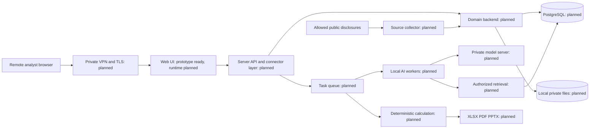

# Предварительный системный дизайн
Обновлено 2026-10-21. Runtime-блоки запланированы, не реализованы. Готовы PRD, архитектурные решения, визуальный прототип и scorer. Детали: [ADR-0001](adr/0001-local-python-architecture.md), [удалённый доступ](adr/0002-secure-remote-access.md), [права и сущности](ACCESS_AND_DATA.md). Эти решения заменяют противоречащие предположения исследования сентября 2026 года.

## Четыре блока
1. Python-first веб-интерфейс: кандидат NiceGUI, проверка в GS-005. HTML-прототип GS-003 описывает UX, не заменяет Python runtime.
2. Backend: FastAPI и PostgreSQL, организации, компании, факты, модели, версии, задания и аудит. Файлы через FileStore в локальном Docker volume.
3. Отдельные локальные AI workers и inference на GPU. Разные модели для OCR/извлечения/сводки допустимы.
4. Серверный слой коннекторов и оркестрации: авторизация, контракты, инструменты, задания, проверка выходов. Клиент не обращается к ИИ напрямую.

## Сущности
Organization, User, Membership, Company, Watchlist, Source, DocumentVersion, RawTable, FactVersion, Evidence, Review, TemplateVersion, ModelRun, Scenario, Export, Job, ModelConfig, PromptVersion, DatasetVersion, ExperimentRun, Annotation, Notification, AuditEvent.
Факт содержит компанию/отчётный периметр, показатель, период, валюту, масштаб, значение, источник/страницу/ячейку, дату публикации, статус проверки и версии.
ModelRun фиксирует набор фактов, формулы, сценарии, версию расчётчика и AI-артефакты. Пересчёт не перезаписывает историю.

## Изоляция
tenant_id обязателен для приватных объектов; права проверяются на API, workers, поиске, экспортах, кэше и файлах. Публичный каталог отделён от загруженных данных фонда. Хеширование не должно раскрывать наличие чужого файла.
Публикация шаблона делает его доступным внутри фонда; публикация заполненной модели требует явного решения о её данных. Нужна отдельная проверка, чтобы шаблон не сохранял скрытые приватные листы.
БД, очередь и inference не доступны публично. Сборщик имеет ограниченный доступ к внешним источникам; ИИ не получает произвольный сетевой доступ.

## Расчёты и знания
ИИ извлекает/сопоставляет данные и объясняет выводы. Финансовую арифметику выполняет детерминированный движок.
RAG находит разрешённые фрагменты источников перед ответом и обеспечивает цитаты. Память хранится отдельно: факты, словарь, инструкции, подтверждённые исправления, датасеты. Это переносимый контекст, а не обещание переноса обученных весов.
Adapter/Wrapper приводит разные локальные модели к единому контракту. LangGraph может управлять шагами и возвратом на ручную проверку; необходимость подтвердить в GS-014. MCP/FastMCP может стандартизировать разрешённые инструменты. CrewAI — только после доказанного преимущества перед явным workflow. На каждую выбранную технологию нужны ADR, рабочий пример и инструкция.

## Качество
Предложение для согласования: accuracy извлечения = число полностью правильных фактов / число эталонных фактов тестового набора; отсутствующие обязательные факты считаются ошибками. Проверять одновременно значение, единицу, валюту, период и привязку к источнику. Отдельно считать precision, coverage и долю отказов.
Порог >=95% измеряется на отложенном наборе с размером выборки и доверительным интервалом; разрезы по формату и эмитенту. Для формул — эталонные сверки с заданными допусками; для критических финансовых инвариантов и изоляции нельзя допускать «5% ошибок».
Выводы ИИ оцениваются отдельно по подтверждению источниками и ручной разметке. Рыночная оценка не имеет гарантированной accuracy 95%.

## Развёртывание
Пилот работает на подтверждённом компьютере пользователя: Windows 11, RTX 3080 Ti 12 GB. Поставка — Dockerfile(ы), Compose, миграции и инструкция восстановления. GPU-host требует совместимого runtime. Удалённый доступ через частную VPN-сеть, TLS и аккаунты приложения. Внешние порты БД и ИИ не публикуются. Мониторинг после выключения ПК догоняет пропущенные публикации. Облако отложено.

