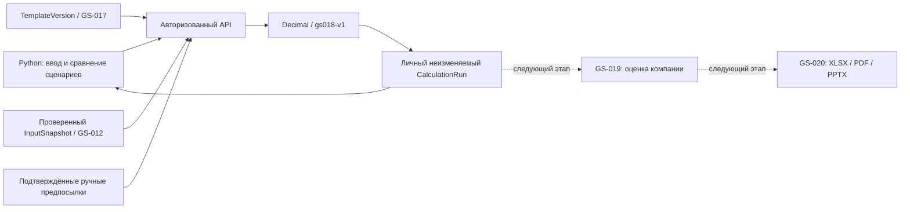

Обновление 2026-10-29: GS-019 реализована. У каждого расчёта есть Value this calculation; методы оценки описаны в [VALUATIONS.md](VALUATIONS.md). Историческое указание о будущем GS-019 ниже относится к приёмке GS-018.

# GS-018: воспроизводимые расчёты
Дата: 2026-10-27. Версия движка `gs018-v1`, миграция `0012`.

Сервер рассчитывает допустимую арифметику шаблона вне ИИ. Сохраняются личные неизменяемые результаты, исходные значения, пояснения аналитика и версии. Это основа для GS-019; методы оценки компании и автоматическое заполнение финансовых моделей пока не реализованы.

## Пользовательский сценарий
1. Templates → выбрать шаблон и версию → Calculate this version.
2. Выбрать компанию. При необходимости загрузить её актуальный проверенный набор входов. При смене компании сначала загрузить её список наборов.
3. Для каждого поля базового сценария ввести ручное значение или выбрать совместимый подтверждённый факт. Объяснить предпосылку либо соответствие определения и периметра. Можно включить optimistic и stress; каждый содержит полный набор входов без скрытого наследования.
4. При необходимости задать контрольные равенства: вычисляемое поле, ожидаемое значение, абсолютный допуск и объяснение. Например, формула assets − liabilities − equity с ожидаемым нулём. Интерфейс допускает три проверки; API — двадцать.
5. Подтвердить все включённые значения и сохранить расчёт. Сравнить сценарии, открыть источники и точные значения. Verify reproducibility повторно вычисляет сохранённые входы и сравнивает SHA-256 результата.

Ручные исторические числа также помечаются как предпосылки. Значения оригинального XLSX автоматически не используются. Денежные значения вводятся в единицах валюты, без масштаба миллионов/тысяч. Доли: 0.05 = 5%. Пропуск не превращается в ноль.

## Статусы и контроль
- `calculated_without_checks`: арифметика выполнена, контрольные равенства не заданы.
- `checks_passed`: все заданные равенства прошли во всех включённых сценариях. Это не утверждение модели и не инвестиционная рекомендация.
- `blocked`: ошибка числа/формулы либо несошедшееся равенство. Частично рассчитанные значения показываются вместе с ошибкой; отсутствие последующих значений явно обозначено.

Пустые, лишние и неподтверждённые входы отклоняются до сохранения. Ошибки деления на ноль, степени, диапазона и несходящиеся контроли сохраняются в заблокированном результате для диагностики. Автоматическое обнаружение всех бухгалтерских равенств не заявляется: проверки задаёт аналитик по структуре шаблона.

## Численная политика
Десятичные строки без промежуточного JSON float. До 34 значащих цифр, 18 знаков после точки, абсолютный вход не более 10^30. Вычисления: Decimal с точностью 34, ROUND_HALF_EVEN. Промежуточные операции также округляются до этой точности. Ошибки области определения/переполнение/потеря точности при underflow блокируют сценарий; абсолютный промежуточный результат ограничен 10^60.

Отображение денежных величин — два знака, прочих — шесть, ROUND_HALF_UP. Отображаемые значения не поступают в формулы и сверки. Проверки сравнивают сохранённые точные десятичные результаты с заданным ожидаемым числом и допуском, с отдельной достаточной точностью вычитания. Округление исходного отчёта не угадывается: аналитик явно задаёт контрольный допуск и пояснение.

Поддерживаются ссылки на описанные ячейки Model, +, −, *, /, ^, скобки, унарный знак. Степень v1 должна быть целым числом от −1000 до 1000; дробная степень явно блокируется. Числовые константы формул — только 0 и 1; остальные параметры задаются входами. Порядок операторов соответствует Excel: унарное отрицание предшествует степени, одинаковые приоритеты выполняются слева направо. Движок не заменяет `^` на Python `**` и не вызывает eval. [Порядок операторов Microsoft](https://support.microsoft.com/en-us/excel/calculation-operators-and-precedence-in-excel), [Decimal Python](https://docs.python.org/3/library/decimal.html).

Это ограниченное подмножество Excel, не обещание побитового совпадения с его двоичной арифметикой. Функции, диапазоны и циклы остаются неподдерживаемыми. После получения пользовательской книги совместимость расширяется с отдельными эталонами и новой версией движка.

## Доказательства и изоляция
CalculationRun содержит фонд/автора, компанию, точную TemplateVersion, версию движка, полный снимок карты, сценарии, источники, контрольные равенства и SHA-256 входа/выхода. API позволяет только создать, прочитать и воспроизвести; изменения/удаление результата отсутствуют. Каждый повтор требует исходную версию движка. Новая версия шаблона или отзыв общего доступа не изменяют уже сохранённый личный запуск. Публикация структуры не раскрывает расчёты. Технический администратор не имеет обхода финансовых ACL.

Факт берётся только из личного актуального проверенного снимка той же компании. Проверяются единицы, валюта и календарный год; годовая длительность — 1 января–31 декабря, instant — 31 декабря. Другие финансовые календари требуют расширения контракта. Определение, учётная база и периметр показываются аналитику и подтверждаются его пояснением; семантическое соответствие не угадывается по названию поля. Прибыль акционеров и полный капитал с NCI не становятся сопоставимыми автоматически.

Проверка актуальности и сохранение выполняются под блокировкой Company, используемой для решений аналитика. Порядок блокировок — User → Company → ModelTemplate; операции шаблонов ссылаются на User перед ModelTemplate. Уникальный Idempotency-Key на автора предотвращает повторную запись. Тот же ключ и другое тело дают 409. После изменения проверки фактов сохранённый результат остаётся историческим, получает предупреждение об устаревании, новый расчёт по старому снимку запрещается. Воспроизведение старого результата не означает повторного утверждения фактов.

## Компоненты

- `calculation_engine.py`: ограниченный парсер, арифметика, округления, сверки и хеши.
- `calculations.py`: схемы входа, права, актуальность фактов, транзакция и replay.
- `calculations_ui.py`: формы сценариев, выбор фактов, таблица сравнения и происхождение чисел.
- `0012_calculations.py`: добавочная миграция без изменения прежних данных.
- `test_calculations.py`, `check_postgres.py`, `check_app.cjs`: численные, интеграционные и браузерные проверки.

## Приёмка
Синтетический прогноз из эталонной книги GS-017: 100 при росте 5% даёт 105; 110.25; 115.7625; 121.550625; 127.62815625. Проверяется независимо заданный список и кэш книги, рассчитанный Artifact Tool. Нулевой рост оставляет 100 во всех пяти годах. Запуск Microsoft Excel не выполнялся.

Полный Windows-прогон: 161 passed, 1 OCR skipped. После финальных изменений численной политики и выбора фактов: 55 целевых тестов passed. Проверяются Excel-приоритеты, циклы/неподдерживаемые формулы, пропуски, численные ошибки, допуски, доступ, неизменяемость, устаревание и replay. Проверки PostgreSQL и браузера фиксируются в карточке GS-018 и CHANGELOG.

GS-004 остаётся REVIEW: независимые реальные эталоны и 95% accuracy не подтверждены. Синтетическая численная проверка не заменяет оценку извлечения данных и инвестиционной методики.
