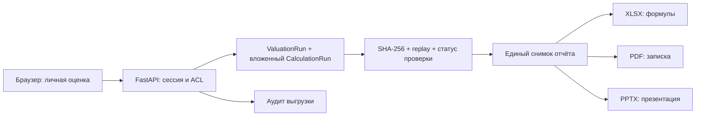

# GS-020 — экспорт личной оценки

Версия `gs020-v1`, 30 октября 2026. Страница Valuations → открыть сохранённую оценку → Download XLSX / PDF / PPTX. Все форматы строятся из одного `ValuationRun`, включая вложенный неизменяемый `CalculationRun`. ИИ и сеть для генерации файлов не нужны.

## Что получает аналитик

- XLSX: Summary; отдельные расчётные листы Calc/Val для включённых сценариев; пересчитываемая Sensitivity; Evidence с точными исходными десятичными строками, предпосылками, определениями, фактами, страницами/ячейками источников и историческими решениями проверки.
- PDF: записка с результатами, чувствительностью, методом и ограничениями; приложение расчётных полей, входов и источников.
- PPTX: редактируемые таблицы сравнения/чувствительности, метод, результаты и приложение источников. Длинные объяснения продолжаются на следующих слайдах, без сокращения текста.

В каждом файле есть дата выгрузки UTC, идентификатор оценки и версия экспорта; полные SHA-256 входов/результата, версия шаблона и движка — в приложении. Котировка показывается только при её явном вводе; отсутствие не подменяется нулём. Банковские методы и ограничения описаны в [VALUATIONS.md](VALUATIONS.md).

## Свежесть и доступ

`GET /api/v1/valuations/{id}/export/{xlsx|pdf|pptx}` требует действующую сессию и совпадение организации и автора. Общий шаблон не делает оценку и файл общими. Чужой ID возвращает 404. Для блокированного сценария, нарушенной целостности, неизвестной версии или неуспешного replay возвращается 409.

Под блокировкой Company сервер считывает статус проверки и воспроизводит сохранённый расчёт/оценку. После этого рендер использует только захваченные данные. Если проверка отозвана, историческая выгрузка доступна с заметным `HISTORICAL`; старые подтверждения в приложении остаются именно историческими. Статус актуален **на указанное время экспорта**, а не навсегда. Для полностью ручного расчёта явно написано, что проверенного набора фактов нет.

Файл генерируется в памяти и не помещается в публичный каталог. Заголовки: attachment, no-store, nosniff, SHA-256 файла и сохранённого результата. Событие `valuation.export` записывает формат, версию, SHA-256 и наблюдавшийся статус проверки. Повторное скачивание может иметь другую дату и байты; числовой снимок и его hash неизменны. Файл после скачивания аналитик распространяет самостоятельно; приложение не может отозвать уже скачанную копию.

## Excel и точность

Формулы строятся из разобранного арифметического дерева GS-018, с явными скобками и заменой ссылок. Внешние книги, макросы, DDE и пользовательские строки как формулы не копируются. Исходный внешний файл не воспроизводится побайтно: выгружается канонический расчётный контракт. Текст, начинающийся с `=`, остаётся текстом.

Числовые входы редактируются на Calc/Val; зелёные формулы связывают оценку с исходным расчётом; Summary читает результаты. Сценарии сохранены раздельно в соответствии с контрактом GS-018, их входы не смешиваются. Чувствительность выводится формулами из того же дерева, её центр следует текущему cost of equity/growth либо multiple. Это обычные формулы, не native Excel What-If Data Tables. Изменение числа акций, котировки, исходной прибыли и финансовых предпосылок пересчитывает зависимые результаты. Пустые/недопустимые входы дают FALSE/ошибку, не нулевую оценку.

OOXML содержит кэш **сохранённых серверных** результатов и требует автоматический пересчёт при открытии. Excel использует примерно 15 значащих цифр binary floating point, сервер — Decimal 34 цифры. После изменения Excel — самостоятельный непроверенный анализ; подпись исходного снимка не подтверждает новые значения. Для воспроизводимого результата нужно создать новый расчёт в приложении. На экстремальных значениях, границах округления и контрольных допусках нельзя обещать побитовое равенство Excel и сервера. Исходные точные строки сохранены в Evidence.

Пересчёт проверен независимым Artifact Tool, включая изменение входов, все точки чувствительности, три сценария, привязку к исходной прибыли, котировку и пустые/нулевые границы. Microsoft Excel и PowerPoint desktop при этой проверке не запускались. Это остаётся частью пользовательской приёмки на целевых версиях Office.

## Реализация и проверки

- `exports.py`: авторизация, целостность, replay, снимок проверки и аудит.
- `export_content.py`: единые числа, подписи, происхождение и разделы для всех форматов.
- `export_workbook.py`: формулы, безопасные текстовые ячейки, кэш результатов, форматирование.
- `export_documents.py`: локальные Python-генераторы PDF/PPTX; фиксированные шрифты и разбиение длинного текста.
- `tests/test_exports.py`: независимые известные ответы четырёх методов, источники, ACL, stale/tampered/blocked, три сценария, котировка, опасные строковые префиксы и длинный текст.
- `scripts/check_exports.mjs`: независимый пересчёт и рендер синтетических файлов. `GS_QA_EXPORTS=1` добавляет реальные скачивания браузером.

Для продуктового Docker по требованию преимущественно Python используются openpyxl, ReportLab и python-pptx; bundled Artifact Tool используется для независимой проверки и презентации этапа. У [ReportLab](https://pypi.org/project/reportlab/) закреплена версия 5.1.0; openpyxl не используется как расчётный движок ([официальная документация формул](https://openpyxl.readthedocs.io/en/stable/formula.html)). В Docker добавлены DejaVu Sans. Дополнительных публичных сервисов генерации нет.

Полный прогон до последних правок оформления: 197 passed, 1 Windows OCR skipped. После добавления проверки трёх сценариев — 9 экспортных тестов passed. PostgreSQL: миграции, идемпотентность, review fencing, replay и восстановление очереди PASS. Браузер: 31 сценарий, без JS-ошибок/внешних запросов/мобильного переполнения. PDF/PPTX и листы XLSX проверены визуально; техническая приёмка не подтверждает GS-004/95% или корректность реальных инвестиционных предпосылок.

## Граница версии

Нет автоматически дописанной ИИ инвестиционной рекомендации, брендинга конкретного фонда, общего доступа к личным оценкам, цифровой подписи Office или загрузки изменённой экспортной книги обратно как утверждённой модели. Полный реальный сценарий JPMorgan и независимая методическая приёмка остаются открытыми. Следующая задача после контрольной точки — GS-021.

