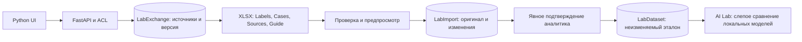

# GS-032 — ручная разметка через XLSX

Личный черновик → заполненная книга → сравнение изменений → подтверждение аналитика → неизменяемый эталон AI Lab. До последнего шага число принятых эталонов не меняется. Финансовые факты, модели и допуск пилота этим действием не утверждаются.

## Работа в кабинете

1. Откройте **AI Lab → Create a dataset**, выберите извлечённый оригинал или подтверждённые факты компании и нажмите **Load evidence**.
2. В **Annotate in XLSX** задайте название и development/holdout. **Prepare annotation workbook** создаёт личный черновик с зафиксированными источниками. Разделение источников резервируется уже здесь.
3. Скачайте **Download annotation XLSX**. Заполните синие ячейки **Labels**: идентификатор источника, код метрики, исходное число, дословную цитату и явно указанный контекст. Неподтверждённый контекст оставьте пустым. Для задачи выбора цитат нужен только evidence_id.
4. На **Cases** явно выберите `labelled` либо `no_relevant_facts`. `unreviewed` не принимается как отрицательный пример. Числа и периоды сохраняйте текстом: числовые и календарные ячейки отклоняются, чтобы Excel не округлял длинные значения.
5. Загрузите книгу через **Preview workbook import**. Кабинет покажет прежнюю и новую разметку, цитаты и пропуски контекста. Проверьте всё, внесите пояснение, отметьте подтверждение и нажмите **Confirm and save reference**.
6. На сохранённом эталоне **Export labels to XLSX** готовит книгу для исправления. Изменение создаёт следующую версию; прежняя сохраняется. Повтор той же операции возвращает прежнюю квитанцию. Полностью одинаковый набор разметки использует уже существующий эталон, без нового дубля.

**Sources** хранит исходный текст по частям, SHA-256 и локатор. **Guide** содержит реквизиты черновика, версии, разделения и справочник кодов метрик. Эти два листа, идентификаторы кейсов и строк менять нельзя. Сортировать строки Labels можно, сохраняя slot/case; удалять строки нельзя, ненужные поля очищаются. Защита листа помогает редактированию, сервер отдельно проверяет содержимое.

## Контракт и ограничения v1

- XLSX до 1 MiB, четыре обязательных видимых листа. До четырёх кейсов и 12 меток на кейс. Кабинет создаёт один кейс за раз; API поддерживает четыре. Пакетный импорт произвольной книги относится к GS-036.
- Источники совпадают с ограниченным входом AI Lab: до восьми элементов выбранного извлечения либо до четырёх подтверждённых фактов. Выгрузка всего PDF/всего корпуса одной книгой не заявляется.
- Формулы, макросы, внешние связи, встроенные объекты, XML DTD и пользовательские формулы проверки ячеек запрещены. Разрешён только встроенный список статусов проверки. ZIP/XML, размеры листов и типы ячеек проверяются до принятия разметки.
- Любая ошибка отклоняет импорт целиком. Оригинал принятого предпросмотра хранится в БД; его можно скачать в истории. Секреты, внешние ИИ и внешние загрузки не используются.
- Изменение источника, более новая версия эталона, смена development/holdout либо уже использованный holdout блокируют сохранение. Проверка повторяется при подтверждении; загруженная книга не обходит эти ограничения.
- Сохранение использует тот же транзакционный порядок блокировок, что AI Lab. Повторные загрузки и подтверждения не создают дублей. Доступ только у автора внутри своей организации; администратор не получает доступ к чужой разметке.

## Компоненты и сущности

`lab_workbook.py` отвечает за буквальные значения, оформление, ограничения пакета и сверку строк. `lab_exchange.py` проверяет владельца, источники, версии и квитанции. `lab_exchange_ui.py` показывает путь импорта на Python. `ai_lab.save_dataset` сохраняет единый контракт эталона для кабинета и XLSX. Миграция **0019** добавляет `lab_exchanges` и `lab_imports`; оригинал XLSX включён в обычный дамп БД. Backup-образ и приложение обновляются совместно.

Новые AI framework не требуются: разметка и сравнение выполняются детерминированно. Эталоны находятся вне весов ИИ и могут применяться при замене модели через существующий адаптер/AI Lab. Это перенос проверочных данных, а не автоматическое обучение весов.

## Проверки и границы результата

Полный локальный набор до финального ограничения формул проверки: **329 passed / 1 skipped**, финальный набор XLSX — **24 passed**. Chrome прошёл новый путь и 15 базовых сценариев без JS-ошибок, внешних запросов и мобильного переполнения. PostgreSQL подтвердил конкурентный импорт/подтверждение без дублей; Linux OCR прошёл. Проверены точность длинных чисел, контекст, отрицательный пример, источники, старые версии, development/holdout, приватность, CSRF, повреждённые книги и повторные запросы.

Восстановление схемы 0019 вернуло **37 таблиц и четыре файла**, оригинал импорта, подтверждение эталона, прежние AI-попытки и PDF checkpoint. Прошли **15 HTTPS-сессий**. Это отдельный синтетический стенд, не полевая проверка носителя или сети фонда.

Листы XLSX просмотрены через локальный рендер. Проверка повторного сохранения книги в Microsoft Excel/LibreOffice пользователем ещё предстоит. Реальные эталоны остаются неразмеченными, accuracy/precision/coverage 95% и десятиминутное обновление не подтверждены.
