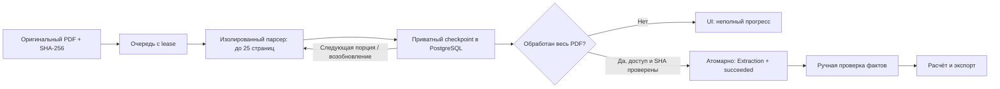

# GS-025 — полные годовые PDF

Обновлено 4 ноября 2026. PDF обрабатывается порциями по 25 страниц. Оригинал не разрезается и не переписывается: номера страниц и SHA-256 относятся к загруженному файлу. Результаты остаются `unreviewed`; завершение извлечения не означает проверку финансовых фактов.

## Работа аналитика

1. В **Files & jobs** загрузите английский PDF до 50 MiB, дождитесь проверки оригинала и нажмите **Extract English document**.
2. **Refresh processing status** показывает сохранённые страницы, например `Incomplete extraction: 25 / 372 pages saved`. Прогресс обновляется после каждой полной порции. До первой порции количество страниц ещё не показано.
3. **Cancel extraction** останавливает задание. Текущий дочерний процесс прекращается при ближайшей проверке lease, обычно в пределах 5 секунд. Сохранённый префикс остаётся.
4. После отмены или ошибки **Retry processing** продолжает с последней сохранённой страницы. При падении worker с действующим заданием очередь продолжит его после истечения lease. Незавершённая порция будет обработана заново, сохранённые страницы не дублируются.
5. **View extracted evidence** доступно только после обработки всего PDF. Над таблицей указано общее число исходных страниц. Печатная нумерация внутри отчёта может отличаться от номера страницы PDF.

Частичный прогон не создаёт `Extraction`, поэтому недоступен для нормализации, предложений ИИ и расчётных входов. Все включённые факты по-прежнему утверждает аналитик. Обработка пустой страницы учитывается в покрытии; предупреждение `pages_without_extractable_content` означает, что на некоторых страницах ничего не распознано. `complete` означает посещение всех страниц, а не полноту распознавания каждой таблицы или диаграммы.

## Компоненты и хранение

- `extraction.py` выбирает исходные страницы, извлекает текст/ячейки/OCR и возвращает диапазон покрытия. Версия PDF — `gs025-pdf-v1`; XLSX/PPTX сохраняют `gs010-v1`.
- `parser_process.py` запускает отдельный процесс на порцию, проверяет порядок страниц, лимиты и суммирует префикс. Порядок элементов стабилен: страницы по возрастанию, внутри — прежний порядок извлечения.
- `jobs.py` записывает checkpoint под блокировкой строки задания, проверяет актуальность lease и доступ автора. Перед возобновлением проверяются хеш оригинала, версия парсера и хеш checkpoint. Хеш оригинала повторно проверяется после парсинга.
- Миграция `0016` добавляет `extraction_checkpoints`: версия документа, версия парсера, SHA-256 источника/JSON, число сохранённых/всех страниц и JSON сырых элементов. Префикс обновляется после каждой порции; архив отдельных порций не создаётся. Завершённый результат и статус задания сохраняются одной транзакцией, checkpoint удаляется.
- Доступ к прогрессу проходит тот же ACL автора/организации, что и оригинал. При отзыве сотрудника или замене lease старый worker не записывает результат. Изоляция остаётся прикладной, это не PostgreSQL RLS.

API: `GET /api/v1/jobs/{id}` и список документов возвращают `progress` только авторизованному владельцу. `POST .../cancel` требует CSRF и активного извлечения; `POST .../retry` разрешён после `failed` или `cancelled`. Частичный `GET .../extraction` возвращает 409.

## Ограничения и восстановление

| Граница | Значение |
|---|---|
| Исходный файл | 50 MiB |
| PDF / порция | 1 000 страниц / 25 страниц |
| Общий результат PDF | 50 000 элементов, до 16 MiB JSON |
| Результат одного процесса | 8 MiB JSON |
| Linux-процесс | 3 GiB адресного пространства, 180 с CPU |
| Время | до 180 с на PDF-порцию и 600 с на одну попытку PDF |
| OCR | английский, до 30 с на страницу, 25 млн пикселей |
| XLSX/PPTX | прежние 50 000 элементов / 8 MiB; PPTX до 250 слайдов, до 300 с на процесс |

Предел PDF увеличен с 8 до 16 MiB по измерению полного HSBC: 13 343 245 байт, 44 512 элементов. Порция и общий счётчик элементов остаются ограниченными. Попадание в любой лимит оставляет задание незавершённым; успешный результат не подменяется обрезанной версией. Ручной повтор даёт новую ограниченную попытку, а не гарантирует прохождение того же превышенного лимита.

Checkpoint находится в БД и входит в зашифрованную копию вместе с оригиналом. Для схемы `0016` нужны соответствующие app/ops-образы. Копию прежней схемы `0015` восстанавливают соответствующими прежними образами на отдельный чистый стенд, затем выполняют миграцию. Новая версия recovery намеренно не принимает несовпадающую схему. При `invalid_pdf_checkpoint` не исправляйте сохранённые факты вручную: загрузите новую версию оригинала для нового извлечения, сохранив историю старой попытки.

## Доказательства и ограничения

Полный JPMorgan 2025: 364 страницы, 16 580 элементов, 127,46 с; максимум RSS дочернего процесса 116 820 KiB. SHA-256 оригинала `2a3ee9733eafd01e7667c5540fbd797c4cc688d14f00638a877f5623d1316d9d`. Старый образ возвращал `extraction_limit` за 1,02 с.

HSBC 2025: 372 страницы, 44 512 элементов; прежний общий предел 8 MiB сработал после 200 сохранённых страниц. Диагностическая проверка полного результата заняла 227,47 с. Итоговый прогон с пределом 16 MiB — **292,60 с**, максимум RSS дочернего процесса **139 396 KiB**, результат **13 343 245 байт**. Оригинал: `94aab2f5c83d1060ee95d344f1915833869fe4502dc635e4ab9ca84f496ee94b`.

Измерения — единичные локальные прогоны CPU/OCR в контейнерах без сети, с пределами 2 CPU / 3 GiB памяти. Это максимум RSS одного дочернего процесса, не пиковая память всей системы. На компьютере одновременно выполнялись другие проверки; это не нагрузочный SLA. Полный путь с ручной проверкой и экспортом за 10 минут и качество ИИ 95% ещё не подтверждены. Оба семейства годовых отчётов 2025 используются как development и исключаются из будущего blind holdout.

Проверки: длинный синтетический PDF, границы элементов/байтов, испорченный файл, сбой порции, отмена, истёкший/заменённый lease, отзыв сотрудника, сохранённый последний checkpoint, подмена источника, чужой доступ. Linux OCR проверяет скан на 26-й странице после 25 пустых страниц и совпадение результата после продолжения. PostgreSQL проверяет отмену во время работы. Восстановление на чистом стенде проверяет продолжение с 26-й страницы, 15 HTTPS-сессий и сохранение ACL. Браузер проверяет прогресс, повтор, полное извлечение и мобильную вёрстку.

Команды: `python -m pytest -q`; Linux `python - < scripts/check_postgres.py` в web и `python - < scripts/check_extraction.py` в worker; `python3 scripts/check_recovery.py`; на Windows `$env:GS_QA_PDF_CHUNKS='1'` и `python scripts/check_browser.py`. Последняя команда создаёт и отзывает синтетический аккаунт. Скриншоты `design/previews/pdf-progress-desktop.png`, `pdf-progress-mobile.png` и `pdf-complete-desktop.png` остаются локальными.
