# Мониторинг отчётности — GS-022

1 ноября 2026. Отдельный локальный контейнер monitor проверяет официальные раскрытия и выбранные финансовые показатели; уведомления доставляются только в личный раздел **Updates**. Он не изменяет подтверждённые факты, расчёты или оценки.

## Пользовательский сценарий

1. Добавьте компанию в Watchlist или нажмите **Follow reporting** в Updates. Подписка совпадает с избранным; удаление из избранного прекращает новые уведомления, уже доставленная история сохраняется.
2. Monitor проверяет поддерживаемые источники примерно каждые 6 часов, пока компьютер и контейнеры работают. После простоя просроченные источники проверяются по очереди. Нужен хотя бы один активный подписчик.
3. Первая успешная проверка каждого источника сохраняет baseline. Исторические отчёты не рассылаются как новые. Изменения после baseline попадают в ленту и счётчик Updates. Счётчик обновляется раз в минуту на открытой видимой странице; саму ленту обновите для просмотра новых карточек.
4. В карточке изменения видны причина, старое и новое число, валюта/единица, период, accession, официальная ссылка и исходные JSON до/после. **Mark as read** меняет только ваш статус.
5. Откройте официальный отчёт, загрузите английский оригинал, проверьте факты, сохраните новый набор входов и выберите шаблон для нового расчёта. Создаётся отдельный CalculationRun/ValuationRun по существующему процессу; автоматического переноса новых XBRL-чисел в старую модель нет.
6. В Coverage видно время последней попытки/успеха, следующая проверка и ошибка. **Request check** ставит источники в очередь; между попытками действует 15-минутный общий cooldown. Кнопка не обходит проверку контакта SEC и ограничения коннектора.

## Покрытие

Для JPMorgan, HSBC и Nu проверяются два фиксированных адреса data.sec.gov: `submissions/CIK##########.json` и `api/xbrl/companyfacts/CIK##########.json`. Произвольные URL, редиректы и сторонние агрегаторы не используются. SEC User-Agent получает контакт из локального GS_SEC_CONTACT; он не попадает в события или интерфейс.

Submissions: 10-K, 10-Q, 20-F, 40-F, 6-K и их /A; 8-K/8-K/A с Items 2.02 или 4.02. 6-K может содержать нефинансовые сведения — интерфейс требует проверить релевантность. /A означает поправку к раскрытию; это не доказательство бухгалтерского рестейтмента. Item 4.02 показывается как non-reliance disclosure, требующее проверки.

Используется только recent-массив SEC. Дополнительные архивные файлы из `filings.files` не обходятся. Поэтому большой простой и выпадение отчёта из recent могут привести к пропуску. Это мониторинг доступного окна, не полная историческая сверка.

Companyfacts: только фиксированные стандартные теги прибыли, капитала и активов из TAGS в public_sources.py, пространства us-gaap/ifrs-full. Окно начинается с 1 января третьего предыдущего календарного года UTC. Произвольные custom tags, сегменты, все операционные показатели и текст PDF не сравниваются. Пустой набор выбранных метрик не доказывает отсутствие новой отчётности.

Сбербанк и Т-Технологии: **english_connector_gap**. Официальные ссылки доступны в Sources, но автоматическое английское покрытие не заявляется; перевод не выполняется.

## Сравнение и защита от повторов

- Снимки исходных JSON сохраняются по SHA-256 байтов, оригинал скачивается после проверки хеша. Каждый источник имеет отдельный baseline и состояние ошибки: сбой XBRL не отменяет успешную проверку submissions.
- Для раскрытия идентификатор — accession. Изменение порядка JSON-массивов не создаёт событие. Новая /A-публикация, изменение метаданных существующего accession и новые раскрытия различаются.
- Для числа идентификатор — namespace, tag, unit, start, end. Значения разбираются Decimal без округления. Другая валюта/единица или другой период образует отдельный показатель, а не конфликт. Это сравнение опубликованного токена, а не независимая методическая сверка определения.
- При нескольких раскрытиях выбирается максимальная пара filed/accession. Противоречивые значения в одном таком контексте дают ошибку источника, вместо произвольного выбора. Ответ с более старым filed/accession не возвращает уже известное число назад.
- Повтор того же числа в новом accession не создаёт ещё одно уведомление. Семантический fingerprint события исключает повторную доставку той же версии. Исчезнувшие записи не удаляются из наблюдений: recent — скользящее окно.
- Изменение числа помечается **possible_revision**. Подтверждение рестейтмента требует изучить отчёт и объяснения эмитента; монитор не делает этого вывода автоматически.
- Первая ошибка создаёт одно событие. Повторные ошибки не спамят; успешное восстановление создаёт одно событие recovery. Backoff: 5, 10, 20, 40, 80, 160, 320 минут, далее максимум 6 часов. Отсутствие контакта SEC — повтор через 6 часов.

## Компоненты и восстановление

```mermaid
flowchart LR
  Watch[Избранное активных аналитиков] --> Scheduler[Monitor connector / проверка сроков]
  Scheduler --> SEC[Fixed SEC connector / shared request lock]
  SEC --> Raw[MonitorSnapshot / исходные JSON]
  Raw --> Index[monitor_index / Decimal / смысловые ключи]
  Index --> State[MonitorSource + MonitorObservation]
  State --> Events[MonitorEvent / deduplication]
  Events --> Delivery[SiteNotification / org + owner]
  Delivery --> UI[Python Updates / личное прочитано]
  UI --> Review[Аналитик / новый набор / новый расчёт]
```

Миграция **0015** добавляет пять таблиц и шесть фиксированных источников. `monitoring.py` — планировщик/API/доставка, `monitor_index.py` — правила сравнения, `monitoring_ui.py` — Python-страница, `monitor_worker.py` — отдельный цикл с фоновым heartbeat. `public_sources.fetch` поддерживает только два допустимых SEC endpoint.

Проверка проходит под тем же PostgreSQL row lock на служебной строке компании, что и существующие SEC-запросы. Сеть ограничена размером 20 MiB и тайм-аутами; запросы разделены как минимум секундой. Один общий запрос обслуживает всех подписчиков. HTTP-вызов остаётся внутри транзакции: при падении процесса соединение освобождает lock, наблюдения и доставка откатываются вместе; следующая итерация повторяет проверку. Длительный запрос может задержать другую операцию, использующую этот lock; это известный компромисс локального пилота. Heartbeat продолжается отдельно.

Публичные ответы/события общие; строки доставки содержат org_id и owner_id. Только владелец может читать уведомление и менять read_at. Администратор не получает чужую ленту. Отозванные аккаунты не запускают проверки и не получают новые события. Монитор не обращается к ИИ и не занимает GPU. Контейнер monitor подключён к ingress/private для исходящих HTTPS-запросов, не публикует порты и не монтирует app_data. Файловый worker и inference остаются только в private-сети. Остановка monitor явно показывается в Updates; просмотр сохранённых данных остаётся доступным.

## Проверки и границы

Живые проверки 1 ноября прошли для всех шести источников: HSBC facts 12 наблюдений / submissions 853; JPM 35 / 8; Nu 6 / 177. Это число отобранных записей, не число полных отчётов и не доказательство исторической полноты. Исходный recent JPM содержал свыше 26 тысяч записей; лимит валидатора расширен до 100 тысяч при сохранении предела ответа 20 MiB.

Тесты проверяют baseline, /A, повторные публикации, смену значения, единицы/периоды, устаревший ответ, невалидный JSON, backoff/recovery, ACL, приватный read state, контроль исходного хеша и интерфейс. PostgreSQL проверяет конкурирующие проверки, единственный запрос, атомарное событие и повторную отметку прочтения. Скриншоты изменения 100 → 110 получены из синтетической тестовой базы; это не реальное изменение активов JPMorgan.

Запуск синтетической визуальной проверки: сначала `python -m pytest tests/test_monitoring.py`, затем `scripts/check_monitor_ui.cjs` с bundled Playwright. Live smoke: `GS_QA_MONITOR=1` для `scripts/check_browser.py`; создаётся временный QA-аналитик и отключается после проверки. Публичные baseline остаются в общей БД согласно правилу сохранения данных.

GS-004/95% и независимая приёмка остаются открытыми. Проверка на 15 одновременных аналитиках, резервное восстановление и защищённый удалённый доступ относятся к следующим задачам.

Первичные источники проверены 1 ноября 2026: [SEC API](https://www.sec.gov/search-filings/edgar-application-programming-interfaces) — submissions/recent и companyfacts; [SEC Developer Resources](https://www.sec.gov/about/developer-resources) — умеренная частота и идентификация автоматического доступа.
