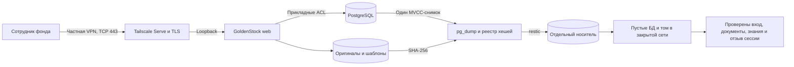

# Пилот GoldenStock на Windows и WSL

2 ноября 2026. В учебном восстановлении отдельный PostgreSQL и чистый файловый том прошли сверку. Приложение открыло исходный PDF, Excel-шаблон и подтверждённый набор знаний. Вход с устройства фонда, носитель резервных копий и доступность после перезагрузки Windows требуют полевой приёмки GS-023.



## Частный вход

Фонд выбрал Tailscale на Windows-хосте. Подключение сотрудников согласовано как отдельный этап. Администратор фонда регистрирует хост в частной сети, включает MagicDNS, HTTPS и unattended mode, назначает хосту тег `tag:goldenstock`. Пример в `ops/tailnet-policy.example.hujson` разрешает группе аналитиков TCP 443. Замените учебные адреса реальными и объедините правила с действующей политикой фонда. Grants и ACL суммируются. Проверьте существующие широкие разрешения, тесты запрета и отсутствие публичного Funnel для хоста. [Tailscale Serve](https://tailscale.com/docs/features/tailscale-serve)

1. Узнайте DNS-имя хоста в PowerShell через `(tailscale status --json | ConvertFrom-Json).Self.DNSName.TrimEnd('.')`. В приватном окружении оператора WSL задайте `GS_REMOTE_ORIGIN` как полный HTTPS-origin этого имени и `GS_WEB_PORT` как действующий loopback-порт. На этом пилоте используется 8081. Для `GS_RUNTIME_PASSWORD` сгенерируйте 32 случайных байта в виде 64 hex-символов. Храните окружение вне checkout с правами 0600. Порядок исходной установки и загрузки весов описан в RUN_LOCAL.md и LOCAL_AI.md.
2. В WSL из корня проекта выполните команды ниже. Оператор миграций выдаёт приложению отдельный логин с DML-правами. Web, worker и monitor получают эту роль. Изоляцию личных объектов обеспечивают прикладные ACL. В схеме 0015 количество таблиц с RLS равно нулю. Один web-процесс ограничивает попытки входа с одного адреса до 30 за пять минут. За прокси этот лимит может быть общим для сотрудников. Для нескольких процессов потребуется общий ограничитель.

```sh
docker compose run --rm --no-deps -T -e GS_RUNTIME_PASSWORD migrate python - < scripts/provision_runtime.py
docker compose -f compose.yaml -f compose.remote.yaml up --build -d --wait web worker monitor
docker compose exec -T web python - < scripts/pilot_status.py
```

3. Проверьте `secure_cookie=true`, `runtime_role=goldenstock_runtime`, `superuser=false` и `bypass_rls=false`. В PowerShell проверьте `tailscale serve status` и `tailscale funnel status`. На выделенном свободном слушателе активируйте `tailscale serve --bg --https=443 http://127.0.0.1:8081`. Вход выполняется по GS_REMOTE_ORIGIN и персональной учётной записи GoldenStock. [Команды Serve](https://tailscale.com/docs/reference/tailscale-cli/serve)
4. С разрешённого устройства выполните `python ops/probe_private_endpoint.py allow https://ИМЯ-ХОСТА`, затем войдите в интерфейс. Повторите после переподключения VPN. Вне сети фонда выполните `python ops/probe_private_endpoint.py deny https://ИМЯ-ХОСТА`. Дополнительно проверьте снаружи реальный WAN-адрес площадки на 443 и 8081 и настройки маршрутизатора. Запишите устройство, время и результат.
5. При отзыве деактивируйте аккаунт GoldenStock в Team, удалите пользователя из VPN-группы и отзовите устройство. Открытая сессия должна вернуть 401, а сетевой тест с отозванного устройства должен показать отказ. Для остановки HTTPS-входа используйте `tailscale serve --bg --https=443 off`.

## Зашифрованное резервирование

PostgreSQL экспортирует единый repeatable-read snapshot для дампа, реестра файлов и сверочных количеств строк. Оригиналы, пользовательские шаблоны и их очищенные копии проверяются по SHA-256. В БД хранятся факты, разметка, знания, публичные источники, расчёты и оценки. Сессии входа и heartbeat исключены из копии. Веса устанавливаются по закреплённым профилям, а секреты восстанавливаются из отдельного хранилища оператора. Снимок получает метку готовности только после успешного завершения restic. В квитанции указывается количество непривязанных файлов для расследования.

После того как оператор подключит отдельный носитель, выполните следующие шаги для рабочих копий. Сейчас восстановление проверяется на тестовом репозитории. Создайте на нём пустой подкаталог репозитория. В WSL проверьте `findmnt -T /путь/к/репозиторию`. В Windows сопоставьте букву тома с физическим диском через Get-Partition и Get-Disk. Экспортируйте три переменные окружения.

| Переменная | Значение |
|---|---|
| GS_BACKUP_MOUNT | Постоянная отдельная точка монтирования |
| GS_BACKUP_REPO | Абсолютный путь к существующему подкаталогу на носителе |
| GS_BACKUP_PASSWORD_FILE | Файл с сильным секретом restic с правами 0600 на файловой системе Linux, вне проекта и резервного носителя. Вторую копию секрета хранит оператор фонда |

```sh
docker build -t goldenstock-ops:local ops
python3 scripts/backup_to_media.py init
# Сохраните выведенный repository_id в GS_BACKUP_REPOSITORY_ID и экспортируйте его.
python3 scripts/backup_to_media.py backup
python3 scripts/backup_to_media.py check
python3 scripts/backup_to_media.py status
python3 scripts/backup_to_media.py list
```

Утилита проверяет монтирование и идентичность репозитория. Временный сжатый дамп и кэш используют tmpfs 1 GiB. При росте БД увеличьте лимит после проверки доступной RAM. `status` возвращает код 2, если последний успешный снимок старше 24 часов или отсутствует. `check` читает все пакеты. Для рабочего расписания приняты ежедневная копия в 02:00 по местному времени, еженедельная проверка и ежемесячное учебное восстановление. Снимки сохраняются бессрочно. Целевой RPO 24 часа зависит от исправности носителя и расписания. RTO фонда измерьте на полном наборе данных.

## Восстановление и откат

Загрузите соответствующую снимку версию кода и образы `goldenstock:local` и `goldenstock-ops:local`. Экспортируйте параметры репозитория, новый `GS_RECOVERY_DB_PASSWORD` в виде случайной hex-строки и полный 64-символьный `SNAPSHOT` из команды list. Выберите ранее не использованное имя Compose-проекта.

```sh
export RECOVERY_PROJECT=gsrecovery_drill_01
docker compose -p "$RECOVERY_PROJECT" -f ops/compose.recovery.yaml up -d --wait recovery-db
docker compose -p "$RECOVERY_PROJECT" -f ops/compose.recovery.yaml run --rm -T restore restore "$SNAPSHOT"
docker compose -p "$RECOVERY_PROJECT" -f ops/compose.recovery.yaml up -d recovered-web
```

Восстановление открывает репозиторий для чтения и требует пустых goldenstock_recovery и файлового тома. Сверяются хеши дампа и файлов, количества строк всех таблиц и ссылки на оригиналы из восстановленной БД. После сбоя сохраните журнал и повторите в новом проекте. Сеть при проверке закрыта. Сверьте отзывы сотрудников после даты снимка, доступ к оригиналам, знаниям и контрольной оценке, а также отложенные задания перед возобновлением worker.

Перед обновлением запишите версию кода, теги образов и ID проверенной резервной копии. Присвойте действующему образу отдельный локальный тег. Обновите checkout, соберите образы, запустите Compose с действующими профилями VPN и GPU. Проверьте readiness, вход сотрудника, профиль ИИ и скачивание оригинала. При совместимой схеме верните прежний образ и версию кода. При несовместимой схеме восстановите предобновленческий снимок в отдельный проект. Оператор согласует записи после точки восстановления, переключает БД и файловый том вместе и повторяет проверки до открытия VPN.

### Переключение на проверенную пару томов

Следующие команды относятся только к выбранному восстановленному проекту. Сначала сверяются пользователи и результаты восстановления. Остановите запись в старом приложении на согласованное окно. Запишите его имя проекта, окружение и порт для обратного переключения.

```sh
docker compose -p "$RECOVERY_PROJECT" -f ops/compose.recovery.yaml stop recovered-web
docker compose -p "$RECOVERY_PROJECT" -f ops/compose.recovery.yaml exec -T recovery-db psql -v ON_ERROR_STOP=1 -U goldenstock -d postgres -c 'ALTER DATABASE goldenstock_recovery RENAME TO goldenstock'
docker compose -p "$RECOVERY_PROJECT" -f ops/compose.recovery.yaml stop recovery-db
docker volume ls --filter "label=com.docker.compose.project=$RECOVERY_PROJECT"
```

В приватном окружении новой установки задайте `GS_RESTORED_DB_VOLUME` и `GS_RESTORED_FILES_VOLUME` по меткам recovery_db и recovery_files, `POSTGRES_PASSWORD` из GS_RECOVERY_DB_PASSWORD и свободный `GS_WEB_PORT`, например 18081. Имя нового проекта должно отличаться от исходной установки и учебного восстановления. Пример команд WSL для отдельного проекта:

```sh
candidate() { docker compose -p gspromoted -f compose.yaml -f compose.remote.yaml -f compose.recovered-volumes.yaml "$@"; }
candidate up -d --wait db
candidate run --rm -T migrate
candidate run --rm --no-deps -T -e GS_RUNTIME_PASSWORD migrate python - < scripts/provision_runtime.py
candidate up -d --wait web worker monitor
candidate exec -T web python - < scripts/pilot_status.py
```

Подключите согласованный GPU-профиль и закреплённые модели по LOCAL_AI.md. Проверьте новый loopback-порт. Перенаправьте приватный Serve на этот порт и выполните проверку с клиентского устройства. Для последующих копий той же установки добавляйте в команду backup имя проекта и overlay с выбранными томами. В `backup.env` установите `COMPOSE_PROJECT_NAME=gspromoted` и `GS_RECOVERED_VOLUMES=1`, укажите восстановленный пароль БД, обе переменные томов и сохранённый ID архива. Выключите расписание исходной установки. При обратном переключении согласуйте новые записи на восстановленном экземпляре до возврата Serve на прежний порт.

## Windows и показатели

Настройте автозапуск Docker в дистрибутиве WSL через systemd либо существующий раздел `[boot]` в wsl.conf, сохранив действующие команды запуска. Службе Tailscale на Windows нужен unattended mode. В Планировщике заданий используйте владельца дистрибутива. Для машины, на которой WSL завершается при простое, можно держать задачу `wsl.exe -d Ubuntu -- /bin/sleep infinity` активной. Запуск до интерактивного входа, питание от сети и таймеры пробуждения проверьте на самом ПК вместе с оператором.

Для ежедневной копии положите экспортируемые shell-параметры носителя в приватный файл `~/.config/goldenstock/backup.env` (владелец — оператор, права 0600). Запустите в WSL `sh ops/nightly-backup.sh`. Он проверяет владельца, права и исключает параллельный запуск. После первой успешной копии в PowerShell выполните `./ops/Register-PilotBackup.ps1`. Задание работает от вошедшего пользователя, ежедневно в 02:00, с запуском пропущенной задачи. У существующего задания регистрация остановится для проверки оператором. Для автономной работы до входа администратор Windows настраивает отдельно согласованный тип входа. Проверяйте LastTaskResult и возраст снимка. После перезагрузки проверьте доступность носителя, Docker, heartbeat monitor/worker и HTTPS со второго устройства.

`docker compose exec -T web python - < scripts/pilot_status.py` показывает готовность, ИИ, сессии, состояния AI-задач, размер БД, свободное место и права PostgreSQL. Порог предупреждения по диску — больший из 10 GiB и 10% объёма тома. Лимит отдельного файла 50 MiB. Если все 45 ежедневных загрузок достигают лимита, только оригиналы займут около 802 GiB за год. Измеряйте БД, версии и резервный репозиторий отдельно.

## Ориентир расходов

На 2 ноября 2026 Tailscale Standard указан по 8 USD за место в месяц. Для 15 оплачиваемых мест это 120 USD в месяц или 1 440 USD в год до налогов. При использовании корпоративной VPN применяется тариф фонда. [Тарифы Tailscale](https://tailscale.com/pricing)

Аренда облака для локального пилота — 0. При условной средней мощности ПК 250 W круглосуточная работа за 30 дней потребляет 180 kWh. При условном тарифе 0,20 USD/kWh это 36 USD в месяц, вместе с указанной VPN около 156 USD в месяц. Фактическую мощность, тариф, стоимость носителя и время аналитика учитывайте отдельно.

## Учебное испытание

8 ноября 2026: актуальная схема — `0017`. Обновлять backup-образ вместе с приложением (`docker build -t goldenstock-ops:local ops`). Репетиция восстановила 34 таблицы, четыре исходных/шаблонных файла, приватный AI-пакет и продолжение PDF с 26-й страницы. Старый backup-образ 0016 корректно отказывает новой схеме. Старую копию восстанавливать соответствующим ей образом, затем мигрировать приложение. Подробности — [AI_BATCHES.md](AI_BATCHES.md) и [LONG_PDF.md](LONG_PDF.md).

```sh
docker compose build web
docker build -t goldenstock-ops:local ops
python3 scripts/check_recovery.py
```

Проверка использует два временных проекта Docker, разные PostgreSQL, учебный TLS-сертификат с проверкой имени, 15 синтетических аккаунтов и отключённый inference. Проверены также отказ резервирования повреждённого оригинала, защита от восстановления поверх данных, CSRF, приватность документа, отзыв сессии и доступность каталога после сбоя AI-задачи. [Документация pg_dump](https://www.postgresql.org/docs/17/app-pgdump.html) · [Документация restic](https://restic.readthedocs.io/en/stable/)

9 ноября 2026, GS-034: текущая схема **0021**. Приложение и backup-образ обновлять совместно. Репетиция восстановила 40 таблиц, четыре файла и 15 HTTPS-сессий: публикацию общей версии с личными уведомлениями и статусами чтения, историю SEC, исходный XLSX разметки с подтверждением, историю AI-попыток и PDF checkpoint. Ранние номера схем исторические. Инструкции — [TEMPLATE_PUBLICATIONS.md](TEMPLATE_PUBLICATIONS.md), [SEC_COMPARISON.md](SEC_COMPARISON.md), [LAB_EXCHANGE.md](LAB_EXCHANGE.md).


9 ноября 2026, GS-036: текущая схема **0022**, 41 таблица. Приложение и backup-образ обновляются вместе. Inventory включает `workbook_mappings.blob_key/sha256`; один оригинал может также использоваться `TemplateVersion` и учитывается однократно. Репетиция восстановила шесть файлов, карту и её подтверждения, прежние данные и 15 HTTPS-сессий. Инструкция — [WORKBOOK_MAPPING.md](WORKBOOK_MAPPING.md). Ранние номера схем и числа файлов выше исторические.
