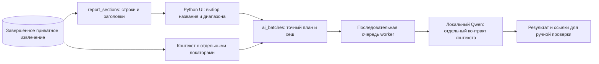

# Разделы отчёта и отдельный контекст — GS-030

Аналитик выбирает финансовый раздел по названию из извлечённого PDF, просматривает предполагаемые страницы и запускает пакет GS-029. Для каждого запроса автоматически добавляются ограниченные фрагменты соседнего текста с собственными ссылками. Все предложения остаются `unreviewed`.

Кандидат `d3319b0ebfc3af2946a2f95fdd2cb8ab713906cb` прошёл [CI 42430313451](https://github.com/Villentretermert/GoldenStock/actions/runs/42430313451): 289 passed / 1 skipped, Docker OCR, PostgreSQL, изоляция и зашифрованное восстановление. Это техническая приёмка GS-030; заполнение контекстных полей и реальные критерии качества остаются открытыми.

## Путь в кабинете

1. Загрузить PDF и дождаться полного извлечения. В AI workspace выбрать документ и нажать **Choose section by title**. Такой же переход есть в Extracted evidence.
2. При необходимости отфильтровать список через **Find title**. Одинаковые названия различаются страницами; источник отмечен `native` или `ocr`.
3. Выбрать раздел и профиль ИИ, нажать **Preview section**. Проверить заголовок, предполагаемый диапазон оригинальных страниц и ссылки на первоисточник.
4. Раскрыть запросы. Основной текст и **Added nearby context** показаны отдельно. Контекст содержит страницу, точный фрагмент и ссылки **Context source** с позициями в исходном извлечении.
5. Нажать **Start selected-page batch**. Открыть нужную часть результата: сохранённый вход и процитированный ИИ контекст доступны по ссылкам. Затем аналитик проверяет смысл и вручную создаёт/подтверждает факт.

Для ручного диапазона страниц **Nearby context** включён по умолчанию. Можно выбрать **Selected pages only**. Прежние API-запросы без нового параметра сохраняют старый режим.

## Что определяется автоматически

Версия v1 распознаёт ограниченный список английских финансовых заголовков: балансы, отчёты о прибыли/совокупном доходе, движении денежных средств, изменениях капитала, финансовые показатели, примечания и несколько обзорных разделов. Заголовок должен совпасть с целой строкой. Строка оглавления с номером страницы или ссылка на раздел в обычном предложении не становится заголовком. Произвольная структура отчёта не гарантируется; при отсутствии подходящего названия используется выбор страниц.

Названия не генерируются ИИ. Для обычного PDF сохраняются точные диапазоны символов; для скана название собирается из OCR-слов одной строки, каждое слово сохраняет исходный индекс и координаты. Смешанные native/OCR-повторы одного заголовка на одной странице объединяются. Текст OCR требует проверки.

Конец раздела предполагается перед следующим распознанным заголовком, либо в конце документа. Это навигационная подсказка, а не подтверждённая структура PDF. Пропущенный или ложный заголовок может изменить границы. При нескольких заголовках на одной странице выбирается вся страница, об этом есть предупреждение. Перед запуском аналитик проверяет диапазон. Если он слишком велик, приложение предлагает выбрать меньший диапазон; обрезки без предупреждения нет.

## Правила контекста и ИИ

Контекст берётся только из того же приватного завершённого извлечения: заголовок, следующая за ним строка, ближайшие строки перед/после основного фрагмента. Учитываются соседние страницы, но переход за найденные границы выбранного раздела ограничен. При отсутствии распознанного раздела близость текста сама по себе не доказывает применимость его периода или масштаба.

Основной вход сохраняется полностью в последовательности запросов. При включённом контексте на него выделено до 4200 символов JSON, на отдельный контекст — до 2200; общий вход провайдера ограничен 7000. Контекст ограничен целыми строками, 600 символами и 32 исходными OCR-словами на фрагмент. Уже включённый основной текст повторно не добавляется; пропущенные из-за лимита фрагменты учитываются и видны в интерфейсе. Пакет по-прежнему ограничен 25 страницами и десятью запросами.

Число и цитата предложения должны происходить из основного входа. Схема не разрешает использовать число только из соседнего контекста. Поле `context_ids` связывает использованные пояснения с сохранёнными отдельными источниками; неизвестная ссылка отклоняется. Валюта/масштаб/период требуют ручного подтверждения: наличие ссылки не гарантирует правильную интерпретацию ИИ. Инструкции внутри любых фрагментов считаются недоверенными данными; явные команды блокируются существующей предварительной проверкой.

Ограничение, найденное на синтетическом браузерном примере: Qwen вернул прибыль 120 и ссылку на контекст, но оставил валюту, масштаб и период пустыми, хотя соседняя строка содержит USD/million/2025. Уточнение инструкции до `metric-proposal-context-v2` этого не устранило. Пустые поля допустимы контрактом и явно показаны как Still missing; сервер не дописывает их за ИИ. Браузерный тест проверяет доставку и сохранение контекста, переходы и допустимость ссылок, а заполнение этих полей выводит отдельной диагностикой качества. Этот пробел остаётся в ручной проверке и GS-004; он не выдаётся за успешное извлечение контекста или 95%.

## Компоненты и версии

`report_sections.py` работает без ИИ и не читает файл повторно. Это позволяет использовать подготовленные извлечения и не расходовать GPU на навигацию. `ai_batches.py` повторно строит план на сервере при запуске и проверяет хеш предпросмотра. `inference.py` сохраняет прежний контракт предложений и добавляет отдельные prompt/schema для контекста; `context_ui.py` выводит источники отдельно. Новая база или внешний RAG-сервис не нужны: задача использует ближайший текст уже известного документа.

Схема БД остаётся `0017`. Заголовок, предполагаемые границы, контекст, его политика и контракт ИИ сохраняются в существующих manifest/входах пакета. Старые пакеты GS-029 читаются и повторяются с прежним контрактом. Изменённый предпросмотр отклоняется; дрейф конфигурации блокирует выполнение сохранённого запроса. Доступ ограничен автором внутри организации.

## Проверки и границы приёмки

8 ноября 2026: полный локальный pytest — 289 passed / 1 skipped; пропущенный в Windows OCR проверен отдельно в Linux. Проверены native/OCR-заголовки, точность локаторов, повторы, оглавление, лимиты, чужие аккаунты, сохранённый вход, изменение предпросмотра, отдельные числовые источники и ссылки контекста. PostgreSQL проверил совместимость очереди, отмены и конкуренции. Зашифрованная копия восстановила 34 таблицы, четыре файла и пакет с новым контрактом контекста; прошли 15 HTTPS-сессий и продолжение PDF.

На development-извлечении JPMorgan найден 121 заголовок-кандидат, включая оригинальные страницы 197–201. Это проверка навигации, не разметка эталонов и не доказательство полноты всех разделов. Резерв GS-004 не использован, пользовательские факты не утверждены. Ручная приёмка, реальные 95%, десятиминутное обновление и полевые проверки остаются открытыми. Следующая GS-031 — резерв GPU и явный выбор CPU.

Финальный Chrome-прогон прошёл выбор раздела, локальный Qwen, переход по отдельному источнику контекста, desktop/mobile, прежний пакет выбранных страниц и 15 базовых сценариев. Пробелы валюты/масштаба/периода в диагностике остались null; их успешное извлечение не заявляется. Ошибок JS, внешних запросов и горизонтального переполнения нет. QA-аккаунт отозван. Локальные снимки: `design/previews/report-sections.png`, `section-context.png`, `section-context-mobile.png`, `section-context-result.png`.
