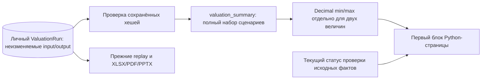

# GS-035 — сценарный диапазон на первом экране оценки

9 ноября 2026. Согласованы обе величины с единицами и раздельное представление методов: [ответы этапа 8](STAGE_8_ANSWERS.md), пункты 8–9.

## Работа аналитика

Открыть личную сохранённую оценку в **Valuations** либо по ссылке компании **Open saved valuation**. Перед экспортом и подробными сценариями расположен блок **Scenario valuation range**:

- **Price per common share** — минимум и максимум цены одной обыкновенной экономической акции, с валютой `/ share`.
- **Common equity value** — минимум и максимум стоимости обыкновенного капитала в полных единицах валюты.
- **Base** — базовый результат каждой величины; у границ перечислены сценарии, которые дали эти значения.
- **Exact bounds and scenario assumptions** — исходные точные границы, входы метода и пояснения аналитика. Методика и отчётный периметр доступны по ссылке рядом.

P/E, P/B, DDM и FCFE остаются отдельными сохранёнными оценками. Диапазон одной оценки не объединяет другие методы, даты, валюты или версии. Каталог и карточка компании по-прежнему ведут к личному результату; первым диапазон показан именно на странице открытой оценки. Сетка чувствительности остаётся ниже и не входит в границы сценариев.

Синтетический пример: прибыль обыкновенных акционеров 90 USD, 10 акций, P/E по сценариям 5 / 10 / 15. Диапазон — **45–135 USD на акцию** и **450–1 350 USD капитала**; базовые значения 90 и 900. Это учебные числа, не оценка эмитента. При разном количестве акций минимум цены и минимум капитала могут относиться к разным сценариям; источники границ вычисляются отдельно.

## Неполные и исторические результаты

**Один сценарий:** показана базовая точка с надписью `Single scenario — range unavailable`. Дополнительные сценарии не создаются автоматически. Если несколько сценариев дали одно значение, это обозначается явно. Если совпало только округлённое отображение, рядом указано, что точные границы различаются.

**Неполный или заблокированный набор:** диапазон недоступен. Все включённые сценарии должны присутствовать и содержать пригодные значения обеих величин. Пропавший, дополнительный, заблокированный сценарий, отсутствующее число, NaN, бесконечность, ноль или отрицательная стоимость не подменяются результатом соседнего сценария. Страница показывает диагностику набора; числовые карточки и экспорт на этом экране скрыты. Существующие проверки серверного экспорта сохраняются.

**Исторический результат:** при изменении проверки фактов исходный диапазон остаётся доступен с маркировкой `Historical result: source review changed`. Это прежний сохранённый расчёт. Его числа не пересчитываются по новым данным. Новая оценка требует актуального проверенного набора, как и раньше.

Статус различает соответствие проверенному снимку фактов, отсутствие такого снимка при ручных предпосылках и изменение исходной проверки. Ни один из них не означает независимую методическую приёмку модели. Границы сценариев не являются доверительным интервалом или обещанием будущей цены.

## Код и точность

`valuation_summary.py` создаёт представление `gs035-v1` из точных строк `value`. Сохранённое округлённое `display` и точки чувствительности не участвуют в выборе границ. При равенстве перечисляются все соответствующие сценарии. Денежный показ использует два знака и HALF_UP, независимо от текущей Decimal precision. Малое положительное значение, которое округлилось бы в ноль, показывается как `<0.01`; точная строка доступна в раскрываемом блоке.

`valuations.py` возвращает дополнительное поле `scenario_summary` после проверки прав, хешей и актуальности источника. `valuations_ui.py` выводит его перед скачиванием, проверкой воспроизводимости и деталями. CSS допускает перенос длинных границ на мобильном экране.

Миграция не требуется: схема остаётся **0021 / 40 таблиц**. Исходные `input`, `output`, хеши, политика расчёта `gs019-v1`, replay и состав экспортов не меняются. Новая сводка не сохраняется как отдельный финансовый факт и не вызывает ИИ.

## Проверки

Целевые тесты первого прогона: **54 passed**. Проверены четыре метода на известных ответах, разные источники границ акции/капитала, влияние округления, точные строки, малые и крупные значения, одиночные/одинаковые/неполные/заблокированные наборы, исторический статус, неизменность хешей, replay, права доступа и экранирование HTML. Полный набор: **371 passed / 1 skipped**. Chrome прошёл четыре метода, диапазон P/E из трёх сценариев, одиночные результаты, раскрытие предпосылок, desktop/mobile, replay и XLSX/PDF/PPTX без JS-ошибок, внешних запросов и переполнения. Скриншоты просмотрены; синтетический аккаунт отозван. [GitHub CI](https://github.com/Villentretermert/GoldenStock/actions/runs/42640272053) опубликованного кандидата `1c9c065e9ee678d960b00b3b1e17c8f1605c70eb` прошёл: 371 passed / 1 skipped, отдельный Linux OCR, PostgreSQL, изоляция и зашифрованное восстановление 0021 / 40 таблиц / четыре файла / 15 HTTPS-сессий.

Реальных принятых эталонов, качества 95%, десятиминутного обновления и методического/полевого допуска эти технические проверки не подтверждают.
