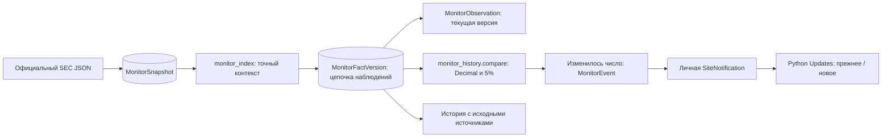

# GS-033 — сравнение значений SEC

На странице **Updates** сначала показываются пересмотры уже наблюдавшихся периодов, затем новые показатели/периоды, затем прочие раскрытия и состояние источников. Доступны отдельные фильтры и личный статус прочтения. Решения согласованы в [STAGE_8_ANSWERS.md](STAGE_8_ANSWERS.md).

## Работа аналитика

Карточка пересмотра ставит рядом **Previous publication** и **New publication**: опубликованное значение, единицу, точные даты периода, дату подачи, форму, accession, описание понятия и ссылку на официальный документ. Каждая сторона имеет собственный исходный JSON и локатор. Ниже — **Observed value history**.

Разница вычисляется только при совпадении namespace, тега, единицы, начала и конца периода; изменившееся известное описание/периметр блокирует автоматическое сравнение. Показатель нового периода не сравнивается с произвольно выбранным прошлым кварталом. Отсутствующий показатель не превращается в ноль. Возможное исправление числа не объявляется подтверждённым бухгалтерским рестейтментом без изучения документа аналитиком.

Порог выделения — `abs(new − old) × 100 >= abs(old) × 5`. Разность сохраняет точность исходных десятичных чисел. Процент равен `(new − old) / abs(old) × 100`, отображается с двумя знаками; порог проверяется до округления. При прежнем нуле процент не определён: показывается абсолютная разница. Числовые отклонения меньше 5% остаются в ленте.

В истории видны начальное наблюдение, изменения чисел и обновления источника при том же числе. Повторная публикация неизменного числа не создаёт уведомление. Возврат к ранее встречавшемуся значению в новой последовательности публикаций — новое изменение, а повтор одного ответа не создаёт дубль. Более старое filed/accession не откатывает известное наблюдение. Рядом с событием всегда сохранён источник предыдущего наблюдения, включая последнюю повторную публикацию того же числа.

Из **Coverage and check status → Observed values and history** можно открыть историю даже без уведомлений. Это история, наблюдавшаяся данным пилотом, а не полная история всех SEC-раскрытий. Сохраняются 20 версий на страницу истории и 50 наблюдаемых показателей на страницу списка. Новые/прочитанные уведомления остаются личными; исходные SEC-данные и их история общие для авторизованных аналитиков.

## Системный дизайн и код

`monitor_index.py` сохраняет описание понятия и локатор оригинального JSON, сохраняя прежний смысловой ключ. `monitor_history.py` добавляет расчёт разницы, буквальную историю с контрольной суммой и API чтения. `monitoring.py` в одной транзакции обновляет историю, наблюдение и личную доставку под существующим общим lock. `monitoring_ui.py` выводит сравнение и историю без ИИ. GPU и модели оценки не вызываются.

Миграция **0020** добавляет `monitor_fact_versions` и указатель `history_id` у текущего наблюдения. Старые наблюдения переносятся как **legacy_baseline**, без выдуманных промежуточных версий; прежние уведомления и JSON сохраняются. Изменение исходника без числовой разницы может создать запись истории, но не уведомление. Повтор неизменного снимка не создаёт ещё одну версию. Схема резервирования также 0020, образы приложения и ops обновляются совместно.

## Покрытие и проверка

GS-033 использует прежний ограниченный SEC-коннектор: выбранные стандартные теги прибыли, капитала и активов. Полное покрытие девяти банковских метрик здесь не добавлено. Их определение и извлечение из документов остаются отдельным сценарием. Английские пробелы российских эмитентов сохраняются.

Основание интерпретации scope: SEC указывает, что companyfacts объединяет факты стандартных таксономий, относящиеся ко всему подающему документы эмитенту, и группирует их по единицам. Это не заменяет методическую сверку периметра финансовой модели. [Официальная документация SEC API](https://www.sec.gov/search-filings/edgar-application-programming-interfaces), проверена 8 ноября 2026.

Полный pytest: **348 passed / 1 skipped**. Проверены синтетические ревизии/новые периоды, повторные публикации и возврат значений, точная граница 5%, отрицательный/нулевой знаменатель, длинные числа, разные единицы/периоды/определения, устаревшие ответы, пропавшие строки, миграция существующих наблюдений, контрольные суммы, атомарный rollback и приватное прочтение. В Chrome открываются реальные Python-страницы из отдельной синтетической тестовой БД; переходы на внешние сайты блокированы. Результаты CI фиксируются в карточке задачи и журнале.

Реальные принятые gold-факты, 95%, десятиминутное обновление и полевая приёмка не подтверждаются этими техническими проверками. Исходные значения SEC не утверждаются автоматически и не записываются в финансовые модели.

8 ноября: Chrome прошёл сравнение и историю на синтетических источниках, также 15 основных сценариев на запущенном кабинете и скачивание шести сохранённых SEC-источников. Последнее не доказывает новый сетевой опрос в этом прогоне: расписание может использовать сохранённый успешный результат. PostgreSQL проверил конкурентные проверки без дублирования истории. Зашифрованная тестовая копия восстановила 38 таблиц, четыре файла, личное уведомление и историю SEC; прошли 15 HTTPS-сессий. Скриншоты desktop/mobile остаются локальными.
