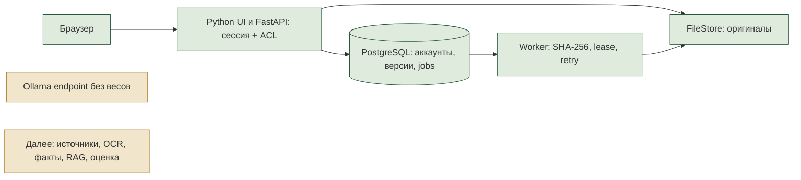

# GoldenStock: обзор GS-005–008
Ответы получены 2026-10-22: см. STAGE_2_ANSWERS.md. Контрольная точка пройдена, следующий этап разрешён ранее данным указанием выполнять задачи последовательно.
Дата: 2026-10-22. Контрольная точка перед GS-009.

## Результат
Приложение работает локально на http://127.0.0.1:8081. Сотрудник входит, выбирает компании, создаёт личный черновик, открывает его название коллегам, загружает оригинал и скачивает сохранённую версию. Фоновый процесс проверяет SHA-256. Финансовые факты, оценка и настоящий ИИ не выдаются за готовые функции.

Презентация: ../deliverables/GoldenStock-Stage-2-final.pptx, 8 слайдов. Рендеры просмотрены; пакет, геометрия, шрифты и повторный импорт проверены. Нативное открытие в PowerPoint не проверялось. Снимки рабочего интерфейса: ../design/previews/workspace-desktop.png, workspace-mobile.png и files-desktop.png.

Облачный черновик остановлен после трёх слайдов: auto-review отклонил добавление локального скриншота и архитектуры без отдельного разрешения на передачу. Полная версия создана локально. Исходники также не опубликованы в публичный GitHub; обновляются только заранее согласованные карточки задач.

## Компоненты и сущности
| Компонент | Что сделано | Сущности |
|---|---|---|
| api.py, ui.py | Python-страницы, JSON API, формы, CSRF/Origin, CSP | контекст запроса |
| auth.py, accounts.py, admin.py | вход, сессии, отключение/отзыв, права и аудит | Organization, User, LoginSession, WorkspaceModel, AuditEvent |
| companies.py | каталог, поиск, избранное, отсутствие/свежесть данных | Company, Favorite |
| documents.py, storage.py | приватные оригиналы, версии, ограниченные загрузки, скачивание | Document, DocumentVersion |
| jobs.py, worker.py | захват, lease, retry, token fencing, проверка SHA-256 | Job, JobEvent, WorkerHeartbeat |
| Docker, Alembic | постоянные volumes, миграции 0001–0004, приватная сеть | PostgreSQL, web, worker, inference |

Модель содержит только заголовок черновика. Документы пока приватны и не прикреплены к общей модели. Это предотвращает неявное раскрытие вложений до реализации публикации provenance в следующих этапах.

## Доказательства
- 36 pytest проходят, включая существующие 12 evaluation-тестов. Это не измерение accuracy ИИ.
- Проверены 15 аккаунтов и две организации; private/shared модель, чужие поиск/файлы/jobs, отказ после отзыва и истечения сессии, CSRF и HTML-экранирование.
- Проверены версии, прежние байты оригинала, несовместимые типы/размеры/ZIP, повреждение файла, ручной retry, три попытки и отказ старому worker.
- PostgreSQL, отдельная временная схема: четыре конкурентных повтора upload → одна версия и job; конкурентный claim → один исполнитель; аварийный выход отдельного процесса → восстановление по lease. Схема удаляется после проверки.
- Chrome на работающем Docker: восемь сценариев от входа до выхода, загрузка/скачивание идентичных байтов и реальный worker. Ошибок JS, внешних запросов и мобильного переполнения нет.
- CI дополнен PostgreSQL проверкой, но GitHub Actions пока не запускался. Один warning TestClient о будущем переходе с httpx на httpx2 не мешает тестам.

## Ограничения и следующие шаги
RLS, TLS/VPN, SSO/MFA, антивирус и эксплуатационные квоты/резервирование ещё не реализованы. ACL проверяется приложением. Оригиналы защищены от перезаписи API, но не от оператора диска. После аварии между записью blob и DB возможен недостижимый файл; автоматического удаления нет. Реальные документы перед общим удалённым пилотом требуют завершения GS-023.

GS-009 определит точные юридические лица и разрешённые публичные источники. GS-010 извлечёт документы; GS-011 нормализует показатели и конфликты; GS-012 даст аналитику проверку со ссылками на оригиналы. Такой порядок нужен, чтобы будущая оценка использовала проверяемые исходные факты. GS-001/004 остаются REVIEW: согласование и независимая разметка не заменены автоматическими тестами.

## 12 вопросов перед GS-009
1. Подтверждаем JPMorgan Chase, HSBC и Nu Holdings как три зарубежные компании пилота?
2. Под Тинькофф моделируем весь публичный холдинг Т-Технологии или отдельно Т-Банк? Для Сбербанка — консолидированную группу?
3. За какой период собирать отчётность: последние три полных года и все доступные кварталы текущего года подходят?
4. Подтверждаем английский язык и входные PDF, PPTX, XLSX? Нужны ли сканы PDF уже в первом наборе?
5. Если английского отчёта нет, показывать пробел или разрешаете локальный перевод с явной маркировкой?
6. Для первого реестра достаточно официальных investor relations и регуляторных раскрытий, без новостных агрегаторов?
7. Какие 10–15 финансовых и операционных метрик обязательны первыми для банков? Подойдут прибыль, капитал, активы, ROE, ROA, NIM, cost/income, NPL и стоимость риска?
8. Кто проверяет эталонный набор: один аналитик или два независимо? Кто разрешает расхождения разметки?
9. Какие ошибки должны блокировать утверждение модели: валюта/масштаб, период, отчётный периметр, расхождение прибыли/капитала?
10. Подходит ли правило: коллеги читают общую модель и создают личную копию, а изменения общей версии делает её автор?
11. Какой ожидается типичный и максимальный объём документа, загрузок за день и допустимое время обработки? Пока лимит 50 MB на файл.
12. Когда нужен защищённый удалённый доступ: после готового расчёта по плану GS-023 или раньше, чтобы коллеги начали тестировать кабинет?

До ответов GS-009 не начинается по пункту 7 PROJECT_RULES.md. Любые новые ответы записывать как уточнения, не заменять ими уже подтверждённые требования без явного противоречия.
