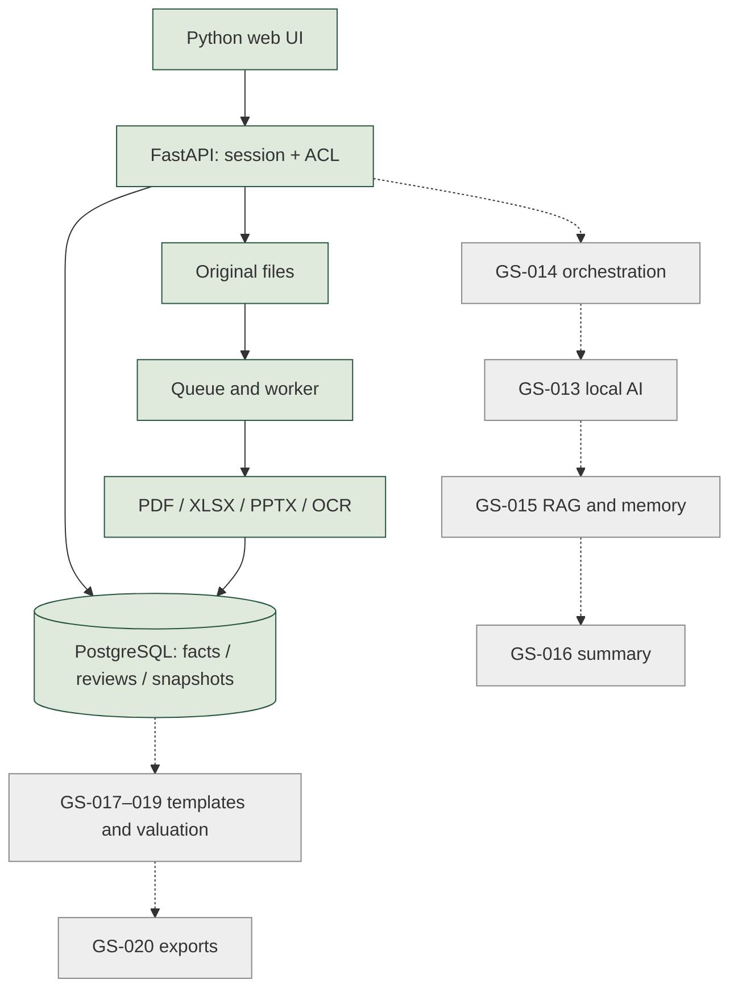

# Обзор этапа GS-009–012
Обновление: все ответы получены 2026-10-23 и сохранены в STAGE_3_ANSWERS.md. Ожидание завершено; текст обзора ниже сохраняет состояние на момент презентации.
Дата: 2026-10-23. Презентация: `deliverables/GoldenStock-Stage-3-final.pptx`.

## Результат
GS-009: реестр официальных источников для пяти согласованных эмитентов. Автоматического сбора пока нет; отсутствие английского отчёта остаётся пробелом.

GS-010: локальное извлечение PDF, XLSX, PPTX и OCR сканов, координаты и оригиналы; изолированный процесс, лимиты, очередь и повторы. Семантическое понимание таблиц OCR ещё впереди.

GS-011: нормализация Decimal, периоды, единицы, валюты, определения и периметр; версии фактов и сопоставимые конфликты прибыли/капитала. Контекст задаёт аналитик, FX не выполняется.

GS-012: источник рядом с фактом, история решений, исправления и проверенные наборы входов. Сервер блокирует набор при критическом конфликте; последующие изменения делают прежний снимок устаревшим. Подробности: ANALYST_REVIEW.md.

## Системный дизайн
Зелёным показано реализованное, серым — будущие блоки.

Цепочка сущностей: DocumentVersion → Extraction → Fact → FactReview → InputSnapshot. `reviews.state()` пересчитывает блокеры и актуальность; `save_snapshot()` применяет запрет на сервере. Браузер не обращается к ИИ. Удалённый защищённый доступ остаётся GS-023, после расчёта.

## Проверки и оставшаяся работа
89 тестов прошли, один Windows OCR пропущен и отдельно проверен в Docker. PostgreSQL проверил конкурентные решения и дедупликацию снимков. Браузер прошёл 15 сценариев; desktop/mobile просмотрены. Это синтетические проверки функций, а не подтверждение 95% accuracy. GS-004 ждёт ручной разметки. Нулевой допуск расхождений требует согласования.

Следующие задачи: GS-013 локальный ИИ с измерением ресурсов; GS-014 серверное управление заданиями; GS-015 поиск по документам и переносимые знания; GS-016 сводка с источниками. Такой порядок позволяет сначала проверить возможности RTX 3080 Ti, затем связать модель с данными. До ответов ниже GS-013 не начинается.

## 12 вопросов контрольной точки
1. Для прибыли и капитала оставить точное сравнение или учитывать округление до единицы представления исходного отчёта?
2. Основная прибыль для оценки: attributable to owners или total profit after tax? Оба определения можно хранить раздельно.
3. Основной капитал: attributable to owners или total equity, включая неконтролирующие доли?
4. Подтверждать вручную все входы перед сохранением проверенного набора или только критические, а остальные — выборочно?
5. Достаточно ли отклонения ошибочного факта с причиной для его исключения из расчётного набора?
6. Предупреждения о валюте/периоде/периметре оставлять неблокирующими после проверки или требовать отдельного подтверждения каждого предупреждения?
7. Первая задача локального ИИ: предложение контекста и метрик из документа или подготовка текстовой сводки?
8. Какое ожидание сводки приемлемо: до 30 секунд, до 2 минут или до 5 минут?
9. Сколько документов в день ожидаете от всех 15 аналитиков суммарно?
10. Можно ли полностью занимать GPU на время обработки или нужно оставить ресурсы для других программ?
11. Сколько времени в неделю аналитик сможет выделять на ручную разметку эталонных документов GS-004?
12. При отсутствии английских отчётов российских эмитентов можно ли первым проверить полный сценарий на JPMorgan, HSBC и Nu, сохраняя пробелы по Сберу/Т-Технологиям?

Ожидаем ответы. Презентация и исходники хранятся локально; прежний запрет на облачную публикацию материалов не обходился.
