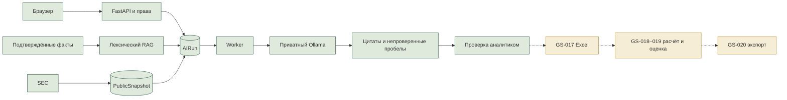

# Этап 4: локальный ИИ и сводки
Дата: 2026-10-24. GS-013–016 завершены в описанном техническом объёме. До GS-017 ждать ответы на вопросы ниже.

## Результат
- GS-013: два локальных профиля Qwen, закреплённые digest, приватный inference, измерения GPU.
- GS-014: серверная очередь AIRun, идемпотентность, lease, отмена/повтор, аудит.
- GS-015: лексический RAG по подтверждённым личным фактам и экспорт knowledge pack. Семантического индекса всего корпуса пока нет.
- GS-016: личные сводки и публичные SEC-сводки JPMorgan, HSBC, Nu. Ссылки на доказательства, даты и оригинал JSON. Сбер/Т-Технологии сохраняют пробел английского покрытия.

## Проверка и исправление
Реальный первый прогон выявил ошибку Nu: свободный пересказ увеличивал прибыль в десять раз при правильной цитате. В summary-v3-extractive сервер заменяет текст утверждения полным текстом выбранного источника. UI старых результатов также показывает цитату вместо пересказа. История старого ответа сохранена. Это ограничивает пересказ, но не подтверждает правильность самих исходных данных или выбора фактов. Пробелы остаются непроверенным текстом ИИ.

После исправления повторно пройдены 18 браузерных сценариев, включая три публичные сводки и скачивание оригиналов. Время inference: JPMorgan 7.514 с, HSBC 7.281 с, Nu 9.126 с. Это один прогон, без гарантии общего времени очереди при 15 сотрудниках. До исправления 105 pytest passed / 1 Windows OCR skipped; после исправления 13 целевых тестов passed, включая регрессию числа. OCR отдельно проверялся в Docker ранее.

## Как пользоваться
Открыть http://127.0.0.1:8081, войти, выбрать компанию и AI workspace. Suggest metrics предлагает метрики из фрагмента документа. Проверить контекст по оригиналу и подтвердить факт в Review. Create summary использует подтверждённые личные факты. Research SEC and summarize получает публичную выборку. Результаты требуют проверки; выбранные периоды могут различаться и не являются полным покрытием всех отчётов.

Wrapper в inference.py даёт единый интерфейс моделей. RAG в knowledge.py ищет факты до запуска модели. AIRun хранит входы и происхождение результата; PublicSnapshot сохраняет публичный оригинал. JSON knowledge pack переносит знания вне весов. LangGraph/CrewAI/MCP отложены: нынешние сценарии линейные и не требуют автономного вызова инструментов. Подробное обучение: LOCAL_AI.md и adr/0004_local_ai_orchestration.md.

## Далее
GS-017–020: контракт шаблонов, расчёт, оценка, экспорты. Затем GS-021–024: AI Lab, мониторинг, защищённый доступ и приёмка. GS-001/004 остаются REVIEW; реальная разметка и 95% не подтверждены.
Локальная презентация: ../deliverables/GoldenStock-Stage-4-final.pptx.

## Контрольные вопросы
1. Подходит ли сводка из дословных фактов с цитатами на первом этапе, пока свободный пересказ чисел отключён?
2. Показывать ли предположенные ИИ пробелы отдельным блоком «требует проверки» или временно скрыть их?
3. Для первой модели выбираем JPMorgan, HSBC или Nu?
4. Пока вашего Excel-шаблона нет, можно создать демонстрационный шаблон с явной маркировкой?
5. Какой горизонт прогноза заложить в шаблон: 3, 5 или 10 лет?
6. Первый прогноз нужен годовой или поквартальный?
7. Нужны ли сразу три сценария: базовый, оптимистичный и стрессовый?
8. Какая валюта результата нужна первой: валюта отчётности или единая USD? При единой валюте потребуется отдельное правило курсов.
9. Какие предпосылки аналитик должен редактировать вручную в первом шаблоне?
10. Если нужной метрики нет, блокировать расчёт или разрешать явную ручную предпосылку с автором и причиной?
11. Что приоритетнее в PDF/PPTX: краткая записка для инвесткомитета или подробная проверка модели и источников?
12. При полном занятии GPU другими программами откладывать ИИ-задачу или разрешать медленный CPU-режим?
