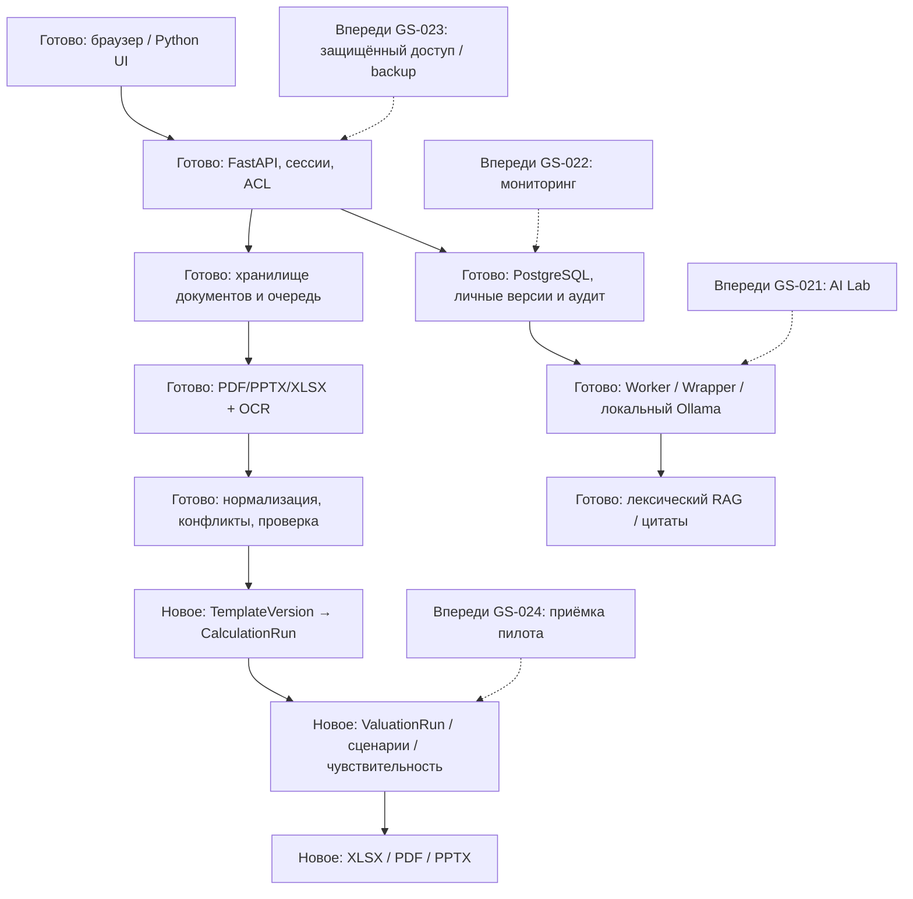

# Обзор этапа 5: GS-017–020

30 октября 2026. Технический этап завершён. Локальная презентация: `deliverables/GoldenStock-Stage-5-final.pptx` (не публикуется в GitHub). Следующий этап начинается после ответов на вопросы ниже.

## Что теперь работает

| Задача | Результат | Основные компоненты |
|---|---|---|
| GS-017 | Контракт XLSX, загрузка/версии, личные и очищенные общие структуры | Template, TemplateVersion, templates.py, template_contract.py |
| GS-018 | Детерминированная арифметика Decimal, до трёх сценариев, контрольные равенства и replay | CalculationRun, calculations.py, calculation_engine.py |
| GS-019 | Банковские DDM/FCFE, P/E/P/B; периметр common equity, чувствительность, MAU/ARPU/retention/LT/LTV | ValuationRun, valuations.py, valuation_engine.py |
| GS-020 | Скачивание XLSX/PDF/PPTX из сохранённой оценки с источниками и статусом проверки | exports.py, export_content.py, export_workbook.py, export_documents.py |

Путь аналитика: загрузить английский документ → извлечь и нормализовать факты → подтвердить все включённые факты → сохранить проверенный набор → выбрать версию шаблона → задать/сопоставить входы сценариев → сохранить расчёт → выбрать метод оценки и подтвердить предпосылки → скачать модель, записку и презентацию.

ИИ предлагает метрики и контекст, но арифметику выполняет серверный движок. Сводка показывает цитаты, а не переписанные моделью числа. Веса ИИ не обучаются автоматически: знания и исправления хранятся отдельно в версиях.

## Системный дизайн

Зелёные/готовые блоки в презентации означают техническую реализацию. Это не подтверждение полноты данных или независимого качества моделей.

## Доказательства и границы

Полный прогон: 197 passed, один OCR skipped в Windows; после последних уточнений — 9 экспортных passed. PostgreSQL проверил конкурентную идемпотентность, блокировки проверки источников, исторический replay, миграции и восстановление очереди. Браузер прошёл 31 сценарий, включая шесть скачиваний для P/E и DDM, без ошибок JS, внешних запросов и переполнения мобильной страницы.

Независимый пересчёт XLSX проверил четыре метода, все точки чувствительности, изменение числа акций, пустые/нулевые входы, три сценария, привязку к исходной прибыли, котировку и недопустимые комбинации. Просмотрены PDF, PPTX, листы Excel и экран скачивания. Office desktop не запускался; совместимость с конкретной версией Office требует пользовательской приёмки.

Примеры синтетические. DDM/FCFE с ежегодным потоком 100, k=10%, g=0, 10 акциями даёт 100 за акцию. P/E с прибылью 100, preferred 10, multiple 10, 10 акциями даёт 90. P/B с капиталом 1000, NCI 100, preferred 100, multiple 1.5, 10 акциями даёт 120. Это контроль арифметики, а не оценка реального эмитента.

GS-004/accuracy 95%, независимый разметчик и методическая приёмка реальных оценок не подтверждены. Нет пользовательского Excel-шаблона и завершённого полного реального расчёта JPMorgan. Оценки и расчёты пока личные; общий доступ реализован для структур шаблонов и метаданных черновика. Нет VPN/TLS, резервного восстановления и нагрузочной приёмки 15 аналитиков.

## Что осталось и почему дальше GS-021

Плановые задачи: GS-021 AI Lab; GS-022 мониторинг новой отчётности; GS-023 защищённый удалённый стенд и резервирование; GS-024 приёмка и годовой пилот. GS-001 и GS-004 остаются REVIEW, их нельзя считать закрытыми из-за завершения разработки. Дополнительные изменения по ответам ниже заводятся отдельными связанными issues, а не скрываются внутри выполненных задач.

GS-021 даст сравнение профилей на одном наборе задач с версиями входов и разметкой. На одной GPU «параллельное сравнение» означает общий эксперимент с управляемой очередью, пока не доказана возможность одновременного inference с сохранением ресурсов другим программам. Сначала измеряем качество и стоимость времени, затем подключаем мониторинг и коллег.

## 12 вопросов перед GS-021 — ожидание ответов

1. Подтверждаем JPMorgan и годовую отчётность 2025 как первый реальный сквозной пример после технического этапа?
2. Для первой независимой методической проверки использовать DDM с P/B как сравнением, или начать с другого метода?
3. Оставить только личные оценки до конца пилота или добавить публикацию внутри фонда с личной копией и изменением общей версии только автором?
4. Кто будет именованным проверяющим реальных исходных фактов и когда сможет начать разметку в пределах ранее согласованных 8 часов в неделю?
5. Какие задания первыми сравнивать в AI Lab: извлечение метрик, выбор цитат для сводки, или оба типа с отдельными оценками качества?
6. Принять accuracy 95% как точность извлечённых метрик на отложенном наборе и отдельно измерять полноту, единицы, период, периметр и корректность цитат?
7. Оставить в первом сравнении два уже установленных профиля Qwen или добавить конкретную другую локальную модель?
8. Для одной GPU подходит последовательное выполнение вариантов одного эксперимента с общей сравнительной таблицей, чтобы сохранять ресурсы другим программам?
9. Удобен полный источник-приложение в PDF/PPTX или нужны отдельно короткая записка/презентация и полный технический пакет?
10. В каких версиях Excel и PowerPoint сотрудники будут открывать файлы: Microsoft 365, более старый Office или LibreOffice?
11. Исторические экспорты после отзыва проверки оставлять с маркировкой HISTORICAL, как сейчас, или полностью запрещать их скачивание?
12. Подтверждаем следующий порядок GS-021 → GS-022 → GS-023 → GS-024 или защищённый удалённый доступ нужен до AI Lab и мониторинга?

Это контрольная точка из PROJECT_RULES.md, пункты 6–7: после четырёх задач презентация, вопросы и ожидание ответов. GS-021 до ответов не начинается.
