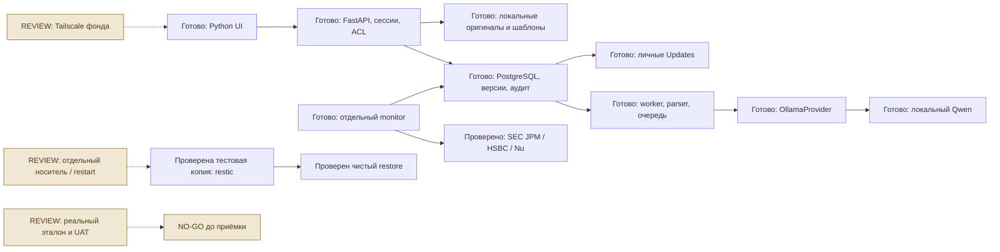

# Обзор этапа 6 — GS-021–024

3 ноября 2026. Технический путь от документа до оценки и экспорта работает. GS-021/022 завершены в заявленном объёме. GS-023 и GS-024 остаются REVIEW, GS-001/004 также требуют приёмки. Подключение фонда сейчас NO-GO до выполнения реальных критериев. Пользователь отложил подключение Tailscale фонда и отдельного носителя.

## Результаты

- **GS-021.** AI Lab хранит версионированные эталоны, запускает два локальных профиля на одинаковых входах, поддерживает слепую разметку, защиту holdout и отдельные метрики чисел/контекста. Реальные 95% пока не измерены.
- **GS-022.** Отдельный monitor проверяет SEC по избранному каждые шесть часов, создаёт личные уведомления, удаляет смысловые дубли и показывает сбой/восстановление источника. Шесть источников JPMorgan/HSBC/Nu прошли живую проверку 1 ноября. По Сберу/Т-Технологиям английское покрытие остаётся пробелом.
- **GS-023.** Подготовлены Tailscale, Secure-cookie и ограниченная PostgreSQL-роль. Две чистые Docker-инсталляции проверили шифрованную копию и восстановление БД/файлов/знаний. Реальные сеть фонда, носитель, расписание и restart Windows ещё не проверены.
- **GS-024.** Добавлен сквозной тест пяти компаний, проверка протокола допуска, ручные сценарии UAT, занятие аналитика и годовой план. Задача не закрыта до реальной приёмки и подписи фонда.

## Проверки 3 ноября

Полный pytest — **246 passed, 1 skipped**. OCR пропущен в Windows и отдельно проверяется в Docker CI. Новые пять сценариев проводят настоящий синтетический PDF через загрузку, parser subprocess, факт, ручное решение через API, снимок, расчёт, оценку и три экспорта. Программа также проверяет чужой доступ, replay, отзыв проверки и HISTORICAL. Ручное действие здесь имитирует тест, человеческая приёмка из него не следует.

Браузер — **31 сценарий**, четыре метода оценки, три сценария расчёта, скачивание XLSX/PDF/PPTX, desktop/mobile. JS errors и внешних запросов нет, горизонтального переполнения нет. Тестовый аккаунт отозван. Синтетический расчёт P/E во всех пяти кейсах даёт 90 USD на акцию, это контрольное число без отношения к реальной цене компаний.

Кандидат `5dd1a9f2ff9926c2b096ac113980c86f499a579e` прошёл [полный CI этапа 6](https://github.com/Villentretermert/GoldenStock/actions/runs/41680299397). Linux pytest 246 passed / 1 skipped, Docker/OCR/PostgreSQL/изоляция и повторное зашифрованное восстановление с 15 HTTPS-сессиями прошли. Обезличенный `evaluation/pilot_acceptance.json` фиксирует три технических passed и восемь pending по реальной приёмке, решение NO-GO, качество N/A.

Репетиция восстановления 2 ноября — 32 таблицы, три файла с SHA-256, подтверждённые знания и 15 HTTPS-аккаунтов. p50/p95 437/467 мс относится к входу и чтению на тестовом стенде. Это не время обработки реального документа и не SLA нагрузки 45 документов/день. Технический CI GS-023 [прошёл](https://github.com/Villentretermert/GoldenStock/actions/runs/41436367753).

## Компоненты и сущности

| Код | Сущности и поведение |
|---|---|
| `ai_lab.py`, `lab_scoring.py` | LabDataset, LabExperiment, LabAnnotation, сохранённые версии, слепое сравнение |
| `ai_runs.py`, `inference.py` | AIRun, общий GPU lease, Wrapper OllamaProvider, закреплённые профили |
| `monitoring.py`, `monitor_worker.py` | MonitorSource/Snapshot/Event, SiteNotification, baseline, дедупликация, backoff |
| `ops/recovery.py` | Единая MVCC-точка БД и файлов, manifest с хешами, restic, проверка чистого восстановления |
| `provision_runtime.py` | DML-роль без superuser/BYPASSRLS, доступ по прикладным ACL |
| `evaluation/acceptance.py` | 11 обязательных критериев, ревизия кандидата, счётчики качества, GO/NO-GO/INVALID |
| `tests/test_pilot_journey.py` | Пять компаний, сквозной HTTP-путь с настоящим парсером, приватность и исторический статус |

## Системный дизайн

RLS в PostgreSQL не реализована, границы организаций обеспечивают прикладные проверки. Monitor имеет исходящий доступ к официальным источникам и не монтирует файлы аналитиков. Worker/inference остаются во внутренней сети. Прямого доступа браузера к локальной модели нет.

## Следующие действия и причина порядка

Сначала назначить аналитика и согласовать протокол GS-004. Затем провести полный путь на реальных отчётах JPMorgan, HSBC и Nu, сверить методику и Office-экспорты. После закрытия финансовых замечаний пройти полевую GS-023 и нагрузку, подписать GS-001/024. Этот порядок даёт доказательство качества результата до подключения всех 15 сотрудников. Подробные приоритеты, зависимости и роли находятся в PILOT_ACCEPTANCE.md.

Локальная презентация — `deliverables/GoldenStock-Stage-6-final.pptx`, 10 слайдов. Презентация и скриншоты остаются локальными. Публичный GitHub содержит исходники, тесты, обезличенный протокол и документацию.

## Вопросы контрольной точки

3 ноября получены все 12 ответов, контрольная точка пройдена. Решения и явно отмеченные трактовки неоднозначных ответов находятся в STAGE_6_ANSWERS.md. Переходим к первому реальному кейсу JPMorgan. Ниже сохранены заданные вопросы для истории. Tailscale фонда и отдельный носитель остаются отложенными.

1. Кого назначаем ведущим аналитиком для разметки и методической приёмки? Достаточно роли или внутреннего обозначения.
2. Подтверждаем JPMorgan как первую реальную модель, затем HSBC и Nu?
3. Подтверждаем рабочий корпус 30 документов/500 фактов и отдельный holdout минимум 6 документов/100 фактов с охватом трёх зарубежных компаний и доступных форматов?
4. Кроме accuracy 95%, принимаем минимальные precision и coverage по 95% с обязательной проверкой контекста и нулём критических ошибок?
5. Продолжаем первый UAT на демонстрационном XLSX v1 или ждём ваш шаблон?
6. Кто подписывает методику DDM/FCFE и выбор сопоставимых компаний для P/E/P/B — ведущий аналитик или отдельный владелец методики?
7. Какие приложения сотрудники используют для XLSX и PPTX — Microsoft Office desktop, LibreOffice или другое?
8. Какой измеримый резерв GPU нужен другим приложениям? Предлагаем начать с 3 GiB свободной VRAM и проверить на вашей реальной нагрузке.
9. Какую максимальную длительность остановки пилота при восстановлении принять как целевую — 4 часа, рабочий день или другой срок?
10. Подтверждаем, что год пилота начинается после подписания приёмки, а не с начала разработки?
11. Подходит ввод 2–3 аналитиков в первый месяц и расширение до 15 после разбора замечаний?
12. Какое сокращение времени от отчёта до проверенного экспорта считать успехом пилота — 25%, 50% или иной порог? Сначала измерим ручной базовый процесс.
