# Обзор GS-025–028

7 ноября 2026. Четыре дополнительные задачи устраняют ограничения, найденные при подготовке реальных отчётов. GS-025–028 завершены в техническом объёме. Всего завершены 24 из 28 задач. GS-001, GS-004, GS-023 и GS-024 сохраняют REVIEW. Реальная приёмка фонда остаётся открытой.

## Что изменилось

| Задача | Изменение | Доказательство |
|---|---|---|
| GS-025 | Длинные PDF обрабатываются порциями, с отменой и сохранением прогресса | Полные JPMorgan 364 страницы и HSBC 372 страницы извлечены. Восстановленный checkpoint продолжает обработку с исходными локаторами |
| GS-026 | Переход к оригинальной PDF-странице, выбор вхождения суммы, подсветка Review | Браузер и сервер проверили повторяющиеся суммы и соседние годовые колонки |
| GS-027 | Крупные XLSX сохраняют заполненные ячейки, формулы и структуру листов | Четыре реальные книги обработаны, адреса сверены с XML оригиналов |
| GS-028 | Предпросмотр ограниченного входа ИИ, сохранённые диапазоны и продолжение | 215 длинных элементов в 24 рабочих документах разделены на 430 окон без потери текста |

На подготовленных оригиналах время извлечения полного JPMorgan составило 127,46 секунды, HSBC 292,60 секунды. Это прошлые технические замеры GS-025. Они не включают очередь ИИ, ручную проверку, модель и экспорт.

В корпусе GS-004 собраны 30 оригиналов, по 10 на JPMorgan, HSBC и Nu. Из них 24 рабочих документа обработаны, шесть кандидатов в holdout хранятся отдельно. Рабочие извлечения содержат 160 865 сырых элементов. При заморозке принято 0 из 500 необходимых эталонных фактов. Нужны разметка, проверка пересечений сравнительных периодов, подтверждение покрытия и отдельный оригинал PPTX. [Состав корпуса](ISSUER_CORPUS.md).

## Как работает новый путь

Files & jobs открывает извлечение. По кнопке Preview AI evidence аналитик видит ограниченный текст с исходным локатором и диапазоном символов. Suggest metrics from this fragment ставит его в приватную очередь. Задача сохраняет точный вход. Preview next fragment продолжает чтение без автоматического запуска модели. Предложение ИИ переходит к полному оригинальному элементу для проверки и создания unreviewed-факта.

Одна задача получает до восьми элементов или часть длинного текста, не более 6000 символов JSON. Заголовки соседних фрагментов не добавляются автоматически. Числовой и отчётный контекст проверяет аналитик. [Инструкция](AI_EVIDENCE_WINDOWS.md).

## Код и сущности

| Компонент | Ответственность |
|---|---|
| `ExtractionCheckpoint`, `jobs.py` | Отдельный частичный прогресс PDF, отмена, lease и возобновление |
| `Extraction`, `extraction.py` | Завершённое извлечение, локаторы и ограниченный компактный XLSX |
| `normalization.py`, `facts_ui.py` | Точное вхождение числа и создание факта с контекстом |
| `ai_evidence.source_window` | Серверный выбор текста, позиции символов и курсор следующей части |
| `ai_runs.py`, `AIRun.input` | Приватный снимок входа, идемпотентность и очередь |
| `OllamaProvider` | Адаптер локальных профилей, проверка digest, JSON и исходных цитат |
| `Review`, `InputSnapshot`, расчёт и экспорт | Решение аналитика, проверенный набор и воспроизводимый финансовый результат |

Wrapper означает адаптер между задачей и конкретным локальным сервером ИИ. Здесь это `OllamaProvider`. RAG выбирает подтверждённые личные факты для сводки. Фрагменты необработанного документа сами в RAG не попадают. LangGraph, CrewAI и MCP на этом шаге не добавлялись, поскольку выбор фрагмента выполняется обычной серверной функцией. Управление доступно через Preview, Next и Local AI profile. Веса модели не обучаются автоматически на принятых фактах.

```mermaid
flowchart LR
  Browser[Готово: Python UI] --> API[Готово: FastAPI и ACL]
  API --> Select[GS-028: выбор исходного фрагмента]
  API --> DB[Готово: PostgreSQL и аудит]
  Files[Готово: приватные оригиналы] --> Parser[GS-025/027: PDF и XLSX]
  Parser --> Extraction[Завершённое Extraction]
  Extraction --> Select
  Select --> Queue[Сохранённый AIRun.input]
  Queue --> Worker[Готово: worker]
  Worker --> Wrapper[Готово: OllamaProvider]
  Wrapper --> AI[Готово: локальный Qwen]
  AI --> Draft[Непроверенные предложения]
  Draft --> Analyst[REVIEW: ручные факты и методика]
  Analyst --> Snapshot[Готово: InputSnapshot]
  Snapshot --> Model[Готово: расчёт и оценка]
  Model --> Export[Готово: XLSX, PDF, PPTX]
  Monitor[Готово: мониторинг SEC] --> DB
  Tailscale[REVIEW: сеть фонда] -.-> Browser
  Backup[REVIEW: носитель и Windows restart] -.-> Files
  classDef pending fill:#f0e7d5,stroke:#88641d,color:#513b13;
  class Analyst,Tailscale,Backup pending;
```

Границы организаций обеспечивают прикладные ACL. RLS в PostgreSQL отсутствует. Браузер не обращается к ИИ напрямую, worker и inference работают во внутренней Docker-сети. GS-028 не меняет схему 0016.

## Проверки

Локальный полный pytest дал **277 passed / 1 skipped**, затронутый набор — 29 passed. Chrome проверил новый путь на настоящем синтетическом PDF с локальным Qwen и 18 прежних сценариев. Финальный прогон после сворачивания длинного входа на странице результата повторил новый путь и 15 базовых сценариев. Ошибок JS, внешних запросов и мобильного переполнения нет. QA-аккаунты отозваны.

На реальном рабочем корпусе выполнена только проверка разбиения исходного текста, без inference и разметки. Все 215 длинных элементов восстановлены из своих окон без изменений. Резервные документы не открывались. Ни один из этих тестов не доказывает accuracy 95% или качество финансовой оценки.

Кандидат кода `b06b9962f50edab78c966b310b39c15b911a2f78` опубликован. [CI этого кандидата](https://github.com/Villentretermert/GoldenStock/actions/runs/42397289892). CI успешно завершился. Linux pytest дал 277 passed / 1 skipped, отдельные Docker OCR, PostgreSQL, изоляция и зашифрованное восстановление прошли.

Локальная презентация `deliverables/GoldenStock-Stage-7.pptx` содержит 10 слайдов с результатами, интерфейсом, сущностями кода и схемой готовности. Все слайды итогового PPTX повторно импортированы, отрендерены и просмотрены. Проверка в Microsoft PowerPoint desktop отдельно не выполнялась.

## Остаток и следующие шаги

GS-004 требует ручного эталона 500 фактов, включая минимум 100 на шести независимых документах, и измерения accuracy/precision/coverage по 95%. GS-024 требует реальных моделей трёх компаний, методики, Office-экспортов и времени полного пути до 10 минут. GS-023 ждёт Tailscale фонда, второго устройства, носителя и перезапуска. GS-001 закрывает приёмка продукта владельцем.

Рекомендуемый порядок после ответов — уточнить единицу измерения десяти минут, подготовить выбранный путь разметки, провести первый реальный JPMorgan, затем HSBC и Nu. Замер этапов даст основание выбирать дальнейшую автоматизацию. Ручная проверка JPMorgan в кабинете, подключение Tailscale и носитель остаются отложенными по решению пользователя. Их повторное подтверждение сейчас не запрашивается.

## Вопросы контрольной точки

8 ноября получены все ответы, см. STAGE_7_ANSWERS.md. Контрольная точка пройдена. Ниже сохранены вопросы для истории.

1. Что первым улучшить после обзора — подготовку ручной разметки в кабинете или пакетный запуск ИИ по выбранным страницам?
2. Цель десяти минут прежде всего относится к первому построению модели компании или к обновлению уже настроенной модели?
3. В первый замер десяти минут включить три основные метрики (прибыль, капитал, активы) или все девять согласованных банковских метрик?
4. Для первичного просмотра отчёта удобнее задавать диапазон PDF-страниц или выбирать раздел по названию?
5. Если контекст фрагмента неполный, предпочитаете автоматическое добавление соседнего заголовка с отдельной ссылкой или ручной выбор дополнительного текста?
6. При недостатке GPU для сохранения резерва 3 GiB задача должна ждать освобождения памяти или предлагать более медленный расчёт на CPU?
7. Для разметки эталонов удобнее работать только в кабинете или нужен экспорт и обратный импорт таблицы разметки?
8. В реальных официальных материалах сейчас нет нативного PPTX. Приемлемо принять этот формат отдельным пользовательским примером позднее или его наличие обязательно до допуска пилота?
9. Когда появятся новые данные SEC, показывать сначала краткую карточку изменения или сравнение новых и прежних значений?
10. При обновлении общей версии модели её автором нужны уведомления всем её читателям или только тем, кто добавил её в избранное?
11. Для первой оценки JPMorgan какой результат показывать первым — диапазон стоимости по сценариям или базовую оценку с раскрытием диапазона?
12. Для пользовательского Excel-шаблона оставить текущий строгий контракт входных ячеек или приоритетнее мастер сопоставления строк произвольной книги?
