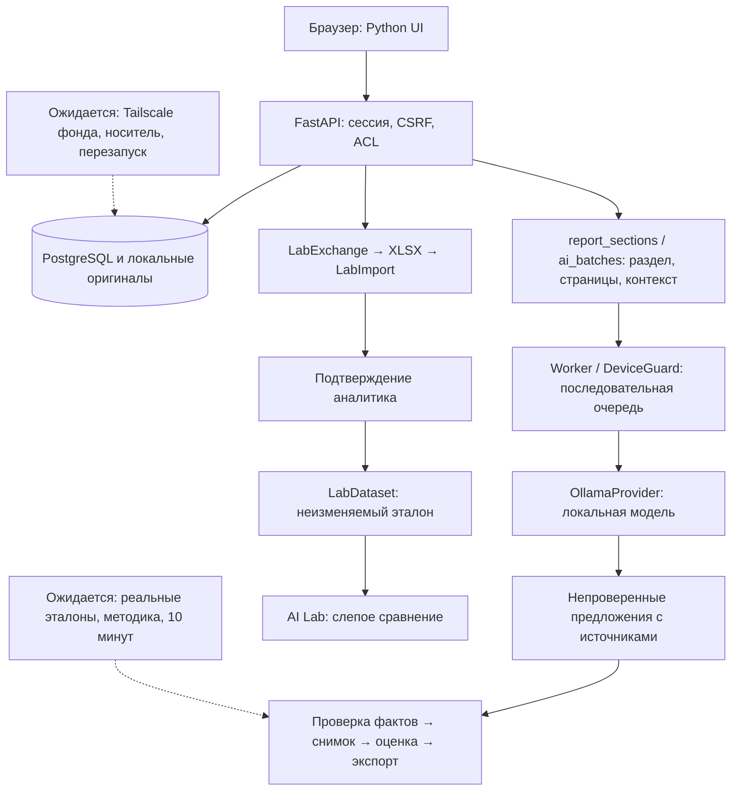

# Обзор этапа 8: GS-029–032

8 ноября 2026. Завершены **28 из 36 задач** в техническом объёме. **GS-001/004/023/024 — REVIEW**, **GS-033–036 — TODO**. После четырёх завершённых задач наступила обязательная контрольная точка: презентация, не менее десяти вопросов, ответы перед следующей задачей. GS-033 ещё не начата.

## Что изменилось и как работает приложение

| Задача | Результат | Граница результата |
|---|---|---|
| GS-029 | Пакет выбранных PDF-страниц, общий прогресс, отмена и повтор неудачных частей | До 25 страниц и десяти AI-запросов в пакете; одна очередь |
| GS-030 | Выбор раздела по названию, соседний контекст с отдельными источниками | Границы предполагаемые; Qwen может оставить валюту/масштаб/период пустыми |
| GS-031 | Контроль резерва 3 GiB VRAM, явный CPU, история попыток | Это допуск и наблюдение, а не аппаратная квота VRAM |
| GS-032 | Личная XLSX-разметка, предпросмотр изменений, подтверждение новой версии | Черновики не являются эталонами; финансовые факты отдельно утверждает аналитик |

Сценарий: аналитик выбирает раздел извлечённого отчёта, проверяет страницы и контекст, запускает пакет локального ИИ. При нехватке GPU явно выбирает CPU или повторную проверку GPU. Для эталонной разметки создаёт книгу из выбранных источников AI Lab, заполняет синие ячейки, загружает результат, сверяет изменения и подтверждает новую версию. Инструкция — [LAB_EXCHANGE.md](LAB_EXCHANGE.md).

## Компоненты и системный дизайн

`AIBatch` сохраняет план и происхождение входов; отдельные `AIRun` фиксируют попытки. `report_sections.py` ищет заголовки без расхода GPU, а контекст получает собственные локаторы. `AIExecution` хранит устройство, время и состояние попытки. Новые `LabExchange` и `LabImport` сохраняют личный черновик, загруженный оригинал и решение аналитика; `LabDataset` остаётся неизменяемым. Схема БД — **0019**.

Клиент вызывает только API. ИИ доступен worker внутри Docker. Framework управления агентами здесь не добавлялся: навигация, проверка ресурсов и импорт требуют воспроизводимых проверок. Знания, инструкции, разметка и результаты AI Lab живут вне весов модели и могут применяться при её замене. Реальная донастройка весов не заявляется.

## Проверки и презентация

Локальный полный pytest: **329 passed / 1 skipped** до последней проверки формул в правилах ячеек; окончательный затронутый набор **24 passed**. Отдельный Linux OCR прошёл. PostgreSQL проверил одновременные импорты и подтверждения без дублей. Chrome прошёл новый путь и 15 прежних сценариев; ошибок JS, внешних запросов и мобильного переполнения нет. Синтетический аккаунт отозван.

На двух отдельных Docker-стендах восстановлены **37 таблиц, четыре файла**, исходный XLSX с записью подтверждения, история AI-попыток и PDF checkpoint. Прошли **15 HTTPS-сессий**, отзыв сотрудника, отказ ИИ и отказ восстановления в непустую БД. Пользовательский кабинет и реальные документы не использовались как эталон.

Опубликованный кандидат `636d2f649f822766edbcbf09842839a7d2e6d687` прошёл [GitHub CI](https://github.com/Villentretermert/GoldenStock/actions/runs/42525972760): **330 passed / 1 skipped**, отдельный Linux OCR, PostgreSQL concurrency, изоляция и зашифрованное восстановление **0019 / 37 таблиц / четыре файла / 15 HTTPS-сессий**. Оригинал импорта, подтверждение эталона, история AI-попыток и продолжение PDF сохранены. Реальные 95%, десятиминутное обновление и полевая приёмка этим не подтверждаются.

Локальная презентация: `deliverables/GoldenStock-Stage-8-2026-11-08.pptx`, десять слайдов. Содержит результаты, три экрана кабинета, компоненты, сущности, системный дизайн и оставшуюся приёмку. Итоговый файл импортирован и отрендерен; все слайды просмотрены. Проверка в Microsoft PowerPoint desktop отдельно не проводилась. Презентация и скриншоты остаются локальными.

## Остаток и последовательность

Следующие задачи после ответов: **GS-033** покажет новые/прежние SEC-значения, **GS-034** доведёт обновление общей модели до читателей, **GS-035** выведет сценарный диапазон первым, **GS-036** позволит сопоставлять строки произвольной Excel-книги. Такое следование сначала объясняет изменения, затем делает их заметными и завершает подключением пользовательской модели.

Четыре REVIEW остаются открытыми. Реальных принятых gold-фактов **0**; корпус содержит 30 оригиналов, включая шесть резервных. Требуются ручная разметка, качество >=95% по accuracy/precision/coverage и ноль критических ошибок, методическая приёмка реальных JPMorgan/HSBC/Nu, Office, измерение обновления готовой модели по девяти метрикам до десяти минут. Полевая эксплуатация ждёт отложенных Tailscale фонда, второго устройства, отдельного носителя и перезапуска Windows. Год пилота начинается после подписания приёмки.

## 12 вопросов контрольной точки

Все 12 ответов получены 8 ноября 2026: [STAGE_8_ANSWERS.md](STAGE_8_ANSWERS.md). Контрольная точка пройдена; продолжать GS-033–036 по плану. Ниже сохранены исходные вопросы.

1. В сравнении SEC показывать отдельно пересмотр уже опубликованного периода и появление нового периода? Рекомендация — раздельно, чтобы не смешивать исправление и рост бизнеса.
2. Сколько прошлых публикаций показывать рядом с новой: предыдущую, три последние или всю историю по запросу? Рекомендация — предыдущую, с доступом к истории.
3. Как выделять важные изменения значений: показывать все одинаково, выделять от 5% или от 10%? Рекомендация — показывать все и выделять от 5%; несопоставимый контекст не сравнивать автоматически.
4. Если источник обновился, но сопоставимые числа прежние, достаточно записи в истории или нужно отдельное уведомление? Рекомендация — история.
5. Под всеми читателями общей модели понимаем всех активных сотрудников фонда с доступом, включая ещё не открывавших её? Рекомендация — да.
6. Уведомление об общей модели отправлять при публикации новой версии или при каждом сохранении автором? Рекомендация — при публикации версии.
7. Достаточно одного уведомления на новую версию модели со списком изменений или нужно отдельное по каждой изменённой метрике? Рекомендация — одно на версию.
8. В диапазоне оценки первым показывать цену акции, общую стоимость капитала или обе величины? Рекомендация — обе с явными единицами.
9. Диапазоны разных методов DDM/FCFE/P/E/P/B показывать раздельно или дополнительно строить общий диапазон только по вручную выбранным методам? Рекомендация — раздельно.
10. В мастере Excel достаточно сначала выбора ячеек для девяти банковских метрик или сразу нужны дополнительные пользовательские показатели? Рекомендация — девять плюс возможность добавить показатель вручную.
11. Если структура Excel-книги изменилась, повторно подтверждать только изменённые сопоставления или все? Рекомендация — изменённые, с доступным полным списком.
12. После ответов продолжать GS-033–036 по плану или сначала расширить книгу разметки на весь выбранный раздел отчёта? Рекомендация — GS-033–036; текущая XLSX-разметка ограничена входом AI Lab.
