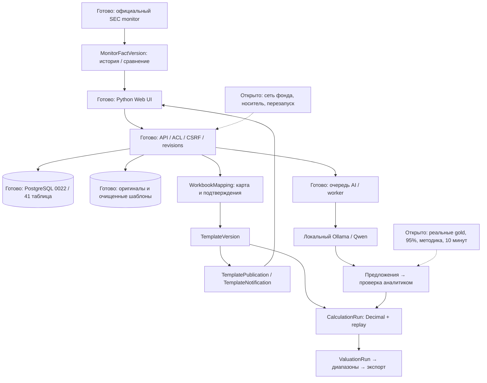

# Обзор GS-033–036

9 ноября 2026. Завершены **32 из 36 задач в техническом объёме**. Четыре задачи реальной приёмки — GS-001/004/023/024 — остаются REVIEW. Новых TODO в согласованном списке нет; дальнейшие задачи определяются после этой контрольной точки.

## Результат этапа

| Задача | Что изменилось | Практический результат |
|---|---|---|
| GS-033 | Отдельные пересмотры SEC и новые периоды, прежнее значение, история, порог 5% | Аналитик видит происхождение и важность изменения |
| GS-034 | Публикации очищенных Excel-версий, предпросмотр и личные уведомления | Все активные читатели фонда получают одно уведомление на версию |
| GS-035 | Диапазоны цены акции и стоимости капитала, базовая точка, статус входов | Оценка начинается со сценарного результата, отдельно по методам |
| GS-036 | Личная Excel-книга, карта ячеек, единицы/масштаб, формулы, изменения и подтверждение | Обычную книгу можно подключить к воспроизводимому расчёту |

Кабинет: **Updates** для SEC и общих шаблонов; **Valuations** для диапазонов; **Templates → Map an ordinary Excel workbook** для мастера. Интерфейс и API работают локально. Скриншоты в презентации содержат синтетические данные.

## Сценарий аналитика

Уведомление ведёт к изменившемуся раскрытию или новой общей структуре. Аналитик просматривает прежнее и новое значение, источники и контекст; проверяет данные и сохраняет снимок. Собственный шаблон можно подключить через карту ячеек: выбрать девять банковских метрик и дополнительные поля, указать единицы, подтвердить изменения и создать личную расчётную версию. Нормализованные числа из книги предлагаются для ручной проверки, без автоматического утверждения фактов. Затем выполняются расчёт, оценка по отдельным методам и экспорт.

В синтетической книге `120 USD millions` превращается в `120000000 USD`, а `2.5 percent` — в `0.025`. Формула между листами `profit/equity` даёт `0.2` и повторяется с тем же хешем. Это технический пример, не модель JPMorgan и не подтверждение методики ROE.

## Компоненты и системный дизайн

| Компонент / сущность | Ответственность |
|---|---|
| `monitor_history.py` / `MonitorFactVersion` | Сопоставимые SEC-значения и сохранённые наблюдения источника |
| `template_publications.py` / `TemplatePublication`, `TemplateNotification` | Неизменяемая публикация и отдельное состояние прочтения для получателя |
| `valuation_summary.py` / существующий `ValuationRun` | Диапазоны точных сохранённых результатов; новые финансовые числа не вычисляет |
| `workbook_mapping.py`, `workbook_maps.py`, `workbook_maps_ui.py` / `WorkbookMapping` | Безопасное чтение, карта, отпечатки зависимостей, подтверждения и версии |
| `TemplateVersion`, `CalculationRun` | Очищенная структура, явные входы, происхождение и повтор расчёта |

Клиент не обращается к ИИ напрямую. RAG, версии знаний, инструкции и разметка остаются вне весов. В этом этапе агентный framework не добавлялся: сравнение чисел, публикации, карты Excel и финансовая арифметика требуют детерминированного поведения. Смена модели ИИ не изменяет сохранённые карты и расчётные снимки.

## Проверки

Полный локальный pytest: **391 passed / 1 skipped**; после финальных проверок границ XLSX — **21 passed** в затронутом наборе. Windows-пропуск относится к OCR; отдельная проверка Linux выполняется в Docker/CI. PostgreSQL подтвердил конкурентную загрузку без дублей, отказ устаревшего редактирования и одну финализацию карты, а также прежние проверки публикаций и расчётов.

Chrome прошёл девять банковских полей, пользовательскую формулу между листами, перевод масштаба, два явных подтверждения, личный шаблон, ручную проверку входов и replay. Прошли также 15 прежних сценариев; нет ошибок JS, внешних запросов и мобильного переполнения. Синтетический аккаунт отозван.

Зашифрованная копия восстановлена на отдельном чистом Docker-стенде: **0022, 41 таблица, шесть файлов, 15 HTTPS-сессий**. Сохранены карта с подтверждениями, оригинал Excel, очищенная версия, публикации и личные уведомления, история SEC, XLSX-разметка и AI-попытки. PDF checkpoint продолжен; отзыв сотрудника и отказ провайдера проверены. Повреждённый исходник и попытка восстановления в непустую БД корректно отклонены.

## Что остаётся

- **GS-001:** реальная продуктовая приёмка и измерение обновления готовой модели по всем девяти метрикам до проверенного экспорта за десять минут.
- **GS-004:** ведущий аналитик — пользователь — размечает реальные факты. Принятых gold-фактов **0**. Корпус 30 оригиналов включает шесть резервных; holdout не используется для разработки. Accuracy/precision/coverage >=95% и отсутствие критических ошибок не подтверждены.
- **GS-023:** пользователь отложил подключение фонда через Tailscale/второе устройство, внешний носитель и полевые проверки; повторный выбор сервиса не требуется.
- **GS-024:** методическая приёмка реальных JPMorgan, затем HSBC и Nu, проверка экспорта в рабочих Office-приложениях и подпись допуска. Решение о запуске остаётся **NO-GO** до выполнения критериев.

Мастер поддерживает разные расположения ячеек, но не весь Excel. SUM/IF/диапазоны, именованные ссылки, VBA и FX-конвертация не исполняются. Нужны явное исключение, ручное решение или дальнейшая разработка по реальному шаблону. Макет исходной книги не воспроизводится в очищенном экспорте. Подробности: [WORKBOOK_MAPPING.md](WORKBOOK_MAPPING.md).

## Следующий шаг и 12 вопросов

Рекомендация после ответов — закончить первый реальный путь JPMorgan и измерить, где теряется время, затем расширять мастер по настоящей книге. Это даст проверяемую обратную связь для четырёх открытых задач приёмки. Ручная сверка, ранее отложенная пользователем, не считается автоматически выполненной.

1. Что приоритетнее следующим: реальная приёмка JPMorgan, подключение вашей Excel-книги или расширение функций мастера?
2. Какой вид первой пользовательской книги брать: исторические банковские показатели, прогноз с оценкой или обе части в одной книге?
3. Какие Excel-функции поддержать первыми после текущей арифметики: SUM/AVERAGE, IF/условия или финансовые NPV/IRR?
4. Как в ваших книгах обычно размещены периоды: по столбцам, отдельными листами или используются оба варианта?
5. В будущем XLSX-результате важнее сохранить исходную вёрстку книги или достаточно стандартизированных Model/GS_Map?
6. При новом числовом обновлении книги нужен отдельный экран «старое / новое / абсолютная и процентная разница» перед расчётом?
7. Следующее ускорение настройки карты: пакетная вставка таблицы сопоставлений или предложения по подписям строк с вашим подтверждением?
8. Для исторических входов первым добавить предложения связей с уже проверенным снимком фактов или продолжать ручной выбор?
9. Нужно ли сохранять отдельное пояснение к каждому исключению неподдерживаемой формулы, кроме текущего общего подтверждения списка?
10. Для первого реального десятиминутного замера обновлять годовую или квартальную версию готовой модели?
11. Точку начала замера считать от появления исходного файла в кабинете или от нажатия кнопки обновления уже загруженного отчёта? Очередь, ручная проверка и экспорт входят в замер.
12. Приёмку XLSX, PDF и PPTX фиксировать отдельными результатами по каждому формату или одной общей записью со списком замечаний?

До следующей задачи дождаться ответов или явного поручения выбрать настройки. Итоговая презентация хранится локально: `deliverables/GoldenStock-Stage-9-2026-11-09-reviewed.pptx`; исходные данные, скриншоты и PPTX не публикуются в GitHub.

Презентация содержит 11 слайдов: результаты, четыре экрана, системный дизайн, компоненты, проверки и открытая приёмка. Финальный PPTX импортирован и отрендерен; все слайды просмотрены, наложения текста исправлены. Проверка в Microsoft PowerPoint desktop отдельно не проводилась.
