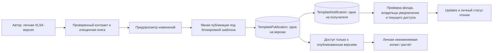

# GS-034 — публикации общих версий и уведомления

9 ноября 2026. Решения пользователя: [ответы этапа 8](STAGE_8_ANSWERS.md), пункты 5–7. Общая версия в этой задаче — **очищенная структура Excel-шаблона GS-017**, которую коллега может использовать или скопировать. Личные расчёты, оценки и исходные документы остаются личными. Ранние карточки Models без версионированной Excel-структуры не создают уведомлений о публикации.

## Работа аналитика

1. В **Templates** сохранить книгу и открыть шаблон. Сохранение создаёт личную версию; уведомления не отправляются.
2. Проверить **Publication preview**: номер новой версии и список изменений относительно последней опубликованной. Видны добавленные/удалённые поля, изменения ячеек, ролей, определений, единиц, периодов и формул. Название и политика контракта также учитываются. Личные входные числа, комментарии и посторонние ячейки не сравниваются для публикации.
3. **Share clean structure with fund** публикует последнюю версию. Каждому активному сотруднику этого фонда, включая автора и не открывавших шаблон, создаётся одно уведомление на сайте. Доставка не зависит от избранного.
4. **Updates → Shared template updates → Open published version** открывает конкретную версию. Сотрудник может создать личную копию. Готовые копии, расчёты и оценки не обновляются автоматически.
5. **Mark template update as read** меняет только личный статус. Общий счётчик Updates учитывает и SEC, и доступные публикации шаблонов. Можно отдельно открыть непрочитанные публикации; страницы содержат до 50 уведомлений.

Если сохранена новая версия, шаблон, как и раньше, возвращается в личный режим. **Make private** также отзывает доступ коллег: их уведомления исчезают из ленты и счётчика, прямые ссылки возвращают 404. Автор сохраняет свою историю. После повторного открытия общей структуры прежние личные статусы чтения восстанавливаются; повторного уведомления на уже опубликованную версию нет. Пропущенные личные черновики не становятся доступными вместе с новой публикацией, в том числе через прямое скачивание или API расчёта.

Состав получателей фиксируется в момент публикации. Отключённые сотрудники не получают новые записи и не могут читать старые. Новые сотрудники могут открыть общую структуру, но им не рассылается история публикаций задним числом. Выбор «включая автора» и отсутствие ретроспективной доставки зафиксированы как рабочие трактовки правила «все активные сотрудники с доступом». Новая версия даже с неизменной очищенной структурой даёт одно уведомление при явной публикации, с соответствующим пояснением.

## Код и системный дизайн

- `template_publications.py`: список изменений, контрольная сумма публикации, атомарная доставка, проверка доступа к версиям, личная лента и прочтение.
- `templates.py`: публикация при явном sharing, блокировка шаблона и проверка файла; загрузка, чтение и копирование с учётом опубликованности конкретной версии.
- `calculations.py`: неопубликованная чужая версия не принимается даже при известном идентификаторе.
- `templates_ui.py` и `monitoring_ui.py`: Python-страницы предпросмотра и уведомлений; браузер обращается только к серверу. ИИ не требуется.

Сохранение публикации, списка получателей, видимости и аудита выполняется в одной транзакции. Уникальные ограничения не допускают вторую публикацию той же версии и второе уведомление одному сотруднику. Повтор с устаревшей ревизией возвращает 409; после перезагрузки повторное sharing успешно без повторной доставки. Чтение уведомления идемпотентно.

Получатель хранится как проверенный идентификатор, без внешнего ключа на User: массовая доставка не должна запрашивать блокировки строк других авторов, одновременно публикующих свои шаблоны. Фонд, активность получателей и право чтения проверяются приложением. При прочтении блокируется только личная запись уведомления. PostgreSQL-тест специально запускает двух авторов параллельно.

## Миграция и эксплуатация

Миграция **0021** создаёт `template_publications` и `template_notifications`. У уже общих шаблонов все ранее доступные версии помечаются как исторически опубликованные; неизвестные даты публикации не выдумываются. Время записи означает перенос истории, а не прежнюю публикацию. Уведомлений об этом переносе нет. Личные шаблоны не публикуются миграцией.

Текущая схема содержит 40 таблиц. Приложение и образ `goldenstock-ops:local` обновлять совместно. Публикации, список получателей и личные статусы входят в дамп БД. Оригиналы и очищенные книги продолжают входить в файловую копию. Данные публикаций никогда не отправляются в SEC или внешнему ИИ.

## Проверка и границы

Целевые тесты: **55 passed**. Проверяются активные/отключённые и ещё не открывавшие шаблон сотрудники, другой фонд, автор, повтор публикации, приватные черновики, безопасная копия и прежний расчёт, отзыв доступа, CSRF, личное прочтение, миграция старых данных, checksum и rollback при сбое доставки. PostgreSQL подтвердил параллельную публикацию двумя авторами, повторную доставку без дублей и личное прочтение. Chrome прошёл публикацию, переход к версии, прочтение, desktop/mobile и прежние сценарии. Зашифрованная копия восстановила 40 таблиц, четыре файла, публикацию и личные статусы 15 сотрудников. Полный pytest: **354 passed / 1 skipped**. Удалённый CI будет записан в карточке задачи и журнале.

Ручные gold-факты, качество 95%, десятиминутное обновление, Microsoft Office и полевой допуск фонда этими техническими тестами не подтверждаются.
