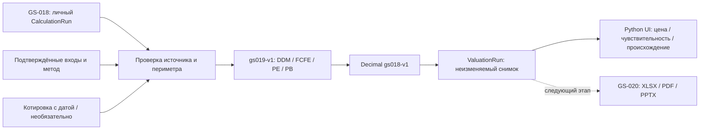

# GS-019: оценка обыкновенного капитала
Дата: 2026-10-29. Политика `gs019-v1`; арифметика `gs018-v1`; миграция `0013`.

Реализованы банковские DDM, FCFE, P/E и P/B поверх сохранённого расчёта GS-018. Результат — личная неизменяемая оценка с допущениями, источниками, сценариями, чувствительностью и повторным воспроизведением. Реальная оценка конкретного эмитента ещё требует подготовленных данных и методической проверки аналитиком; синтетические примеры не являются оценками JPMorgan, HSBC, Nu, Сбера или Т-Технологий.

## Как использовать
1. Открыть личный результат в Calculations → Value this calculation. Исходный расчёт не должен быть заблокирован; его проверенные факты должны оставаться актуальными.
2. Выбрать метод, валюту и опорный финансовый год; при наличии данных включить месячные пользовательские показатели. Load method inputs обновляет форму, не выполняя оценку.
3. Указать дату, обосновать метод, отчётный периметр и базу количества акций. Для DCF подтвердить требования капитала и доступность денежных потоков; для мультипликаторов — сопоставимость банков, учётную базу и выбор множителя.
4. Для каждого поля выбрать совместимое поле исходного расчёта или ввести ручное допущение. Подтвердить смысл каждого сопоставления. Включённые optimistic/stress требуют собственного полного набора входов; имена сценариев должны существовать в исходном расчёте. Никаких незаметных замен пропусков нулями.
5. Необязательно ввести котировку одной обыкновенной экономической акции с датой, валютой, инструментом и источником. Без котировки upside отсутствует. Подтвердить метод и входы, сохранить оценку.
6. Сравнить результат и чувствительность, раскрыть расчётные поля, происхождение входов и методические заметки. Verify valuation reproducibility повторяет сохранённый расчёт. Карточка компании показывает только последнюю личную оценку; актуальность её источников проверяется при открытии.

Все денежные суммы задаются в единицах выбранной валюты. Доли вводятся как 0.05 для 5%. Масштабы тысяч/миллионов не применяются автоматически. Источник-калькуляция проверяется по единицам и периоду, но семантику показателя, IFRS/US GAAP, банковский/холдинговый периметр и корректность прогнозов подтверждает человек.

## Методы
Обозначения: N — количество обыкновенных экономических акций на дату оценки, k — годовая стоимость собственного капитала, g — устойчивый рост после пятого года, Cₜ — годовой денежный поток обыкновенным акционерам.

| Метод | Формула и область применения |
|---|---|
| DDM | Equity = Σ Cₜ/(1+k)^t + [C₅(1+g)/(k−g)]/(1+k)^5. Cₜ — дивиденды обыкновенным акционерам; неотрицательные, пятый год положительный. |
| FCFE | Та же формула; Cₜ — денежный поток обыкновенным акционерам после необходимого реинвестирования/капитала. Промежуточные отрицательные потоки допускаются, пятый год положительный. |
| P/E | Common earnings = прибыль акционеров материнской компании − привилегированные дивиденды. Equity = common earnings × выбранный P/E. |
| P/B | Common book equity = полный капитал − NCI − привилегированный капитал. Equity = common book equity × выбранный P/B. |

Для каждого метода value per share = Equity/N. N > 0; прибыль для P/E, капитал для P/B, множитель и итоговая оценка положительны. Привилегированные корректировки неотрицательны. Отрицательная NCI возможна в отчётности и сохраняется как явный вход. Нулевые корректировки вводятся явно.

Согласованный пользователем полный капитал с NCI остаётся отдельным исходным полем. Он не подменяется капиталом материнских акционеров и не умножается автоматически на common-equity P/B. Прибыль акционеров и полный капитал не используются для автоматического сопоставимого ROE.

Банковский долг и обязательства перед вкладчиками затрудняют обычную оценку FCFF/WACC. Поэтому v1 использует прямую оценку собственного капитала. FCFE не выводится механически из прибыли: необходимый капитал и распределения задаёт аналитик. Выбор соответствует подходам, рассматриваемым в [Damodaran, Valuing Financial Service Firms](https://stern.nyu.edu/~adamodar/pdfiles/papers/finfirm09.pdf). Методический каталог и примеры банковских DDM/P/E/P/B: [NYU Stern](https://pages.stern.nyu.edu/~adamodar/New_Home_Page/Inv2ed.htm).

DCF v1 ограничен датой 31 декабря опорного года и пятью следующими календарными годами с выплатами в конце года. Полугодовая конвенция и неполный первый год не реализованы. 0 < k ≤ 1; −1 < g < k. После пятого года сохраняется единая ставка и темп роста. Доля стоимости из terminal value показывается отдельно. FCFE и DDM не включают автоматически неоперационные активы, новые эмиссии, buybacks, изменения числа акций или отдельную оценку дочерних компаний.

## Котировки и временной контекст
Поддерживаются USD, EUR, GBP, RUB. Валюта котировки обязана совпадать с валютой оценки; GBp не принимается как GBP. Котировка не может быть позднее даты оценки; сама дата оценки не может быть в будущем относительно UTC сервера. При возрасте котировки более семи календарных дней выводится явное предупреждение. Это правило свежести, не численный допуск.

Upside = value per share / supplied price − 1. Показатель не является рекомендацией. Автоматической загрузки котировок нет. ADR и другие депозитарные единицы не поддерживаются непосредственно: до ввода необходима документированная конвертация к обыкновенной экономической акции. Разводнение, классы акций и доля экономического участия отражаются в заметке и N.

Опубликованность всех исходных сведений на историческую дату не установлена автоматически. Оценка хранит дату и источники, но не является проверенным point-in-time backtest; предупреждение отображается всегда.

## Операционные показатели
Модуль добровольный и требует месячные данные одного периметра: выручку R, MAU U, размер исходной когорты A, сохранившихся из неё пользователей B, contribution margin m и месячную ставку дисконтирования d. Месяц должен существовать и не быть позднее даты оценки. Новые пользователи не входят в B. U и A положительны; размеры когорт целые; 0 ≤ B < A; 0 ≤ m ≤ 1; 0 ≤ d ≤ 1; выручка неотрицательна.

- ARPU = R/U за указанный месяц; определение активности пользователь фиксирует в заметке.
- Retention r = B/A за один месяц одной исходной когорты.
- LT = 1/(1−r) месяцев, включая первый оплачиваемый месяц.
- Contribution LTV = ARPU × m / (1+d−r).

Последняя формула предполагает первый платёж в конце месяца 1 и последующие платежи с постоянной вероятностью удержания; вероятность получения платежа t равна r^(t−1). Постоянные ARPU, m, r, d — модельные предпосылки, не вывод об их эмпирической устойчивости. CAC не вычитается. При r = 1 конечный LT не определяется: набор блокируется без выдуманного горизонта. LTV не прибавляется к стоимости банка и не умножается на MAU для автоматической оценки капитала.

Различные моменты первой выплаты дают разные CLV-формулы; используемая конвенция определена явно. См. [Fader & Hardie, Reconciling and Clarifying CLV Formulas](https://brucehardie.com/notes/024/reconciling_clv_formulas.pdf). Предупреждения о применимости постоянного retention: [Beyond the Formula](https://www.brucehardie.com/notes/033/what_is_wrong_with_this_CLV_formula.pdf).

## Чувствительность, ошибки и точность
Для каждого успешного сценария DCF строится сетка 3×3: k ±1 процентный пункт, g ±0.5 процентного пункта, остальные входы фиксированы. Для P/E и P/B используются множители ×0.8, ×1.0, ×1.2. Эти изменения показываются в интерфейсе и входят в версию политики; они не являются погрешностью, вероятностями или доверительным интервалом. Недопустимая точка показывается как Blocked, без подмены ставки.

Используется Decimal-калькулятор GS-018: 34 значащие цифры, HALF_EVEN для операций, HALF_UP для денежных отображений до двух знаков. Для переноса результатов GS-018 сохранены все исходные десятичные разряды; ручные значения подчиняются прежнему лимиту входа. Диапазон входа оценки ограничен |x| ≤ 10^30. Результаты сверок и hashes используют точные сохранённые строки, не округлённое отображение. Численные ошибки блокируют сценарий; итоговый статус blocked, если заблокирован хотя бы один включённый сценарий. Частичная цена не показывается.

## Компоненты и доступ

`valuation_engine.py` строит карты формул и сетки; `valuations.py` проверяет запросы, ACL, актуальность и сохраняет снимки; `valuations_ui.py` отображает формы и результаты. ValuationRun включает исходный CalculationRun с данными/результатами и hashes, разрешённые входы, методические заметки, котировку, политику, автора подтверждения и контрольные суммы. API не предлагает изменение или удаление.

Оценки личные; техническому администратору не даётся доступ к финансовым данным коллег. Публичность структуры Excel или заголовка черновика не раскрывает оценку. PostgreSQL сериализует автора и компанию (User → Company) при проверке фактов/сохранении. Idempotency-Key даёт один результат для повторных запросов; иное тело с тем же ключом отклоняется. Изменение проверки фактов запрещает новую оценку по старому источнику; исторический результат и replay остаются доступны с предупреждением. Replay требует исходную версию политики и движка и проверяет SHA-256.

## Проверки и остаток
Известные синтетические ответы: постоянные годовые C=100, k=10%, g=0, N=10 дают 100 на акцию; P/E при прибыли 100, preferred dividends 10 и multiple 10 даёт 90; P/B при total 1000, NCI 100, preferred 100, multiple 1.5 даёт 120. ARPU 10, m=50%, r=80%, d=10% в месяц дают LT=5 и LTV=16.666… . Проверяются чувствительность, границы, отсутствующие входы, временной контекст, валюты, ACL, CSRF, идемпотентность, устаревание и replay.

Полный прогон перед заключительной UI-доработкой: 189 passed, 1 Windows OCR skipped. PostgreSQL: миграции, конкурентная идемпотентность, блокировка изменений review во время оценки, отклонение устаревшего источника и исторический replay — PASS. Браузерный набор расширен до 28 сценариев; финальные результаты — в карточке GS-019 и CHANGELOG.

Техническая реализация не подтверждает accuracy 95%, полноту данных или независимую финансовую приёмку. GS-004 остаётся REVIEW. Пользовательский Excel-шаблон и реальные примеры требуют проверки на следующем содержательном этапе. Общие финансовые оценки с управлением доступом, автоматический подбор peers, рыночные котировки, расширенные DCF и полноценные cohort-модели не входят в эту версию. Следующая задача GS-020 — три экспорта, затем обязательные презентация и вопросы.
