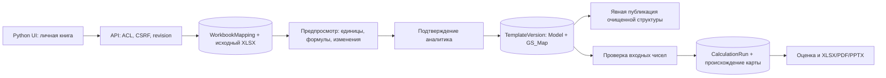

# GS-036 — мастер пользовательской Excel-книги

9 ноября 2026. Технический объём: личная XLSX-книга → карта ячеек → подтверждение → очищенный расчётный шаблон. Это адаптация произвольного расположения строк и листов в ограниченный арифметический контракт, а не полный движок Microsoft Excel.

## Работа аналитика

1. В **Templates → Map an ordinary Excel workbook** загрузить книгу. Оригинал и карта доступны только владельцу внутри его фонда.
2. Просмотреть исходные ячейки по листам, по 100 на странице. Выбрать ячейку или ввести адрес. Доступны `profit`, `equity`, `assets`, `roe`, `roa`, `nim`, `cost_income`, `npl`, `cost_risk` и собственный код показателя.
3. Явно выбрать валюту/единицу, масштаб исходного числа, календарный FYyyyy либо assumption, определение и периметр. Прибыль акционеров и полный капитал с NCI требуют соответствующих описаний; мастер не угадывает их по подписи строки.
4. Предпросмотр показывает исходное число и нормализованное: `120 millions USD → 120000000 USD`, `2.5 percent → 0.025 ratio`. Ячейка Excel с форматом `%` часто уже хранит дробь: `0.025` требует масштаба `units`, а не повторного деления на 100. Формат виден рядом с исходным значением.
5. Для формул выбрать перевод арифметики либо ручной ввод с обязательной причиной. Неподдерживаемая формула блокирует карту, пока её не удалят из выбранных полей или явно не переведут в ручной ввод. Все невыбранные формулы перечислены отдельно; в интерфейсе первые 100, полный оригинал доступен для скачивания.
6. Подтвердить выбранные строки и отдельно принять всю карту, ручные решения, удаления и исключённые ячейки. Финализация создаёт неизменяемую личную версию шаблона. Публикация очищенной структуры фонду — прежнее отдельное действие GS-034.
7. **Review workbook inputs and calculate** открывает нормализованные числа в Base. Проверить их и подтвердить входы перед расчётом. Это ручные предпосылки, не принятые факты и не эталон ИИ. Для optimistic/stress значения вводятся отдельно. В снимок расчёта записываются ID карты, хеш оригинала, версия карты и исходные нормализованные числа.

## Изменения книги

Из финализированной карты загрузить новую версию. Предыдущие файлы, карты и расчёты неизменяемы. До финализации нового черновика опубликованная версия остаётся доступной читателям; после финализации шаблон становится личным до повторной публикации.

Для каждой строки сохраняется отпечаток сопоставления, формулы, числового формата и текстового контекста: заголовки первых десяти строк листа, подписи той же строки и предшествующие подписи того же столбца. Изменение такого контекста требует нового подтверждения соответствующих полей. Зависимые формулы тоже теряют подтверждение. Это консервативная проверка: изменение общего заголовка может затронуть несколько строк. Текст вне этих областей не считается автоматически доказанным контекстом; аналитик проверяет полный оригинал.

Числовое изменение само по себе не меняет карту. Новые значения видны в предпросмотре и требуют подтверждения входов при новом расчёте. Изменение значения не переписывает старый снимок. Полный список сопоставлений всегда доступен. Удалённый/скрытый лист требует исправления или исключения соответствующих полей. Конкурирующий черновик от старой версии нельзя финализировать поверх более новой: нужно начать от актуальной карты.

## Контракт и ограничения

- До 50 MB загружаемого файла, 20 MB распакованных частей, 1000 ZIP-частей, 20 листов, 20 000 непустых ячеек и 40 сопоставлений. Текст ячейки до 2000 символов. Исходный документ может быть больше специализированного шаблона GS-017, но эти лимиты проверяются до сохранения карты.
- Видимые листы, A1-адреса, арифметика `+ - * / ^`, скобки, ссылки между выбранными ячейками разных листов. Все зависимости должны быть сопоставлены. Числовые константы кроме 0 и 1 должны быть вынесены в исходные ячейки и сопоставлены как входы. Диапазоны, SUM/IF и прочие Excel-функции, именованные/динамические ссылки не вычисляются.
- VBA, подключения, внешние ссылки/гиперссылки, внедрённые объекты, DTD и итеративный расчёт отклоняются. Циклы и смешение валют блокируются. FX-конвертация не реализована; арифметическая проверка не доказывает экономическую размерность или корректность методики.
- Масштаб преобразуется до базовой валютной единицы или доли. Переведённая формула восстанавливает исходный масштаб каждого операнда и нормализует результат. Коэффициенты выражены через допустимую арифметику 0/1; прежний парсер GS-018 и его ограничения не ослаблены. Сложные выражения могут превысить его 500 символов/100 токенов и потребуют упрощения либо ручного решения.
- Для числовых входов добавляется технический identity-output `*_mapped`: он повторяет значение и не является оценкой компании. Собственная книга не экспортируется с сохранением исходной вёрстки; создаются листы Model/GS_Map с пустыми входами. Исходник доступен владельцу отдельно.

## Код и данные

`workbook_mapping.py` проверяет ZIP/XML, читает разреженные ячейки, переводит формулы, нормализует предпросмотр и строит отпечатки зависимостей с кэшем. `workbook_maps.py` хранит личные черновики, подтверждения и финализацию. `workbook_maps_ui.py` формирует Python-страницы. `calculations.py` сохраняет происхождение явного импорта входов; старые idempotency-хеши запросов без карты совместимы.

Новая сущность `WorkbookMapping`: организация, владелец, родительская карта, исходный файл/хеш, структурное представление, записи сопоставлений и отпечатки подтверждения, revision, ссылка на `TemplateVersion`. Редактирование сериализовано по владельцу и версии черновика. Повтор загрузки с тем же ключом или финализации возвращает прежний результат. Журнал аудита сохраняет действия и подтверждённые поля; финализированные карты не редактируются API.

Схема **0022**, 41 таблица. Backup включает оригиналы `workbook_mappings`; ссылка того же оригинала из `template_versions` не создаёт дубликат. Операционный контейнер нужно обновлять вместе с приложением. ИИ не выполняет этот шаг: проверяемая карта и Decimal-арифметика остаются детерминированными.

## Проверки и открытая приёмка

Покрыты разные листы/адреса, валюты и масштабы, проценты, зависимости/циклы, неподдерживаемые формулы и явный ручной режим, private/shared границы, старые версии, изменение контекста и чисел, устаревший preview/revision, повтор финализации, происхождение и replay расчёта. Отдельно проверяются реальные PostgreSQL-конкуренция, Chrome и восстановление на чистом стенде. Итоговые результаты — в [обзоре этапа 9](STAGE_9_REVIEW.md).

Реальный шаблон пользователя ещё не предоставлен. Эта реализация не подтверждает 95% accuracy/precision/coverage, методику оценки или обновление готовой модели за десять минут. GS-001/004/023/024 остаются REVIEW.
